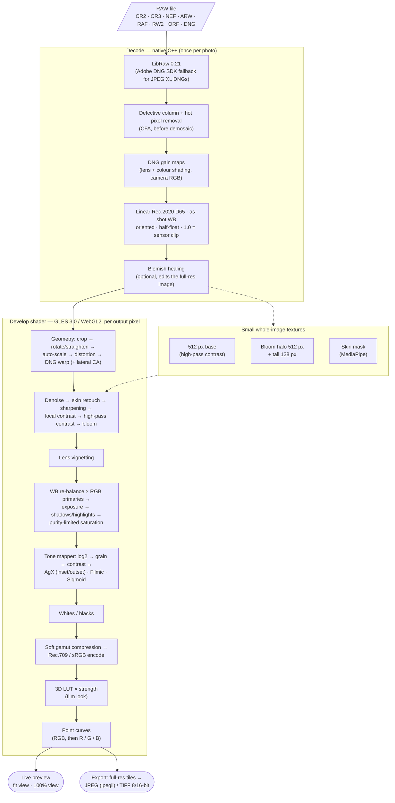

# RawBoy

Android raw developer with an **AgX** tone mapper (RawBoy also offers Filmic and Sigmoid). Three apps share one engine:

- **RawBoy** (`app-pro`): every control, described below.
- **RawBoy Auto** (`app-auto`): develops raws automatically into a film look, one photo or a whole batch
  (see [RawBoy Auto](#rawboy-auto)).
- **RawBoy Camera** (`app-camera`): a camera that previews the film look live and saves each raw shot as a
  JPEG developed by the same engine (see [RawBoy Camera](#rawboy-camera)).
- **RawBoy Film** (`app-camera`, flavour `film`, `app.rawboy.camera.film`): the same camera, whose looks are film
  stocks simulated with [spektrafilm](https://github.com/andreavolpato/spektrafilm) (see
  [Film looks](#film-looks-spektrafilm)). Licensed GPLv3 and developed in its own repository (see [Licence](#licence));
  installs next to RawBoy Camera. On iOS it is the `RawBoyFilm` target (same bundle id), on the `RawBoyFilmEngine` framework.
- **RawBoy Web** (`web/`): RawBoy and RawBoy Auto in the browser, plus **RawBoy Browser** for culling a folder of
  raws, as three tabs (see [RawBoy Web](#rawboy-web)).

- Decoding: **LibRaw 0.21** (CR2/CR3/NEF/ARW/RAF/RW2/ORF/DNG…), with the **Adobe DNG SDK 1.7.1** as fallback for DNGs LibRaw can't read — notably DNG 1.7 with JPEG XL compression (setup: [third_party/README.md](third_party/README.md)). RawBoy Film is built without the DNG SDK (see [Licence](#licence)), so JPEG XL DNGs don't open in it (its own Pixel/iPhone DNGs go through LibRaw).
- Develop pipeline: GLES 3.0 fragment shader, so the preview updates in real time while sliders move.
  Export runs the same shader on full-resolution tiles.
- Export: JPEG (quality 1–100) or TIFF (8/16-bit, lossless LZW compression) to `Pictures/RawBoy/`.

## Controls

| Slider | What it does |
|---|---|
| Tone mapper | **AgX** (default), **Filmic** or **Sigmoid**, per photo (carries over, in the Light preset group). All three use AgX's log range and put middle grey, display white and the slope at grey in the same place, so the sliders below mean the same and switching doesn't change brightness. AgX: Rec.2020 inset/outset, highlights desaturate towards white. Filmic (after darktable's filmic rgb): straight latitude ~1.3 EV each side of grey with rational toe and shoulder, on max RGB with the colour ratios kept, fading to white across the shoulder; slightly lifted deep shadows. Sigmoid (after darktable's sigmoid): a logistic curve in EV per channel with hue preservation; keeps more colour in bright highlights. RawBoy Auto and Camera always use AgX (their film looks are built on it). **Film**: the photo developed as negative + print on a stock (the same 12 stocks and grain/halation as Auto's Film mode), with **Stock**, **Film strength** (blends with the AgX/Filmic/Sigmoid render picked before), **Film grain** and **Halation** (0..200, 100 = the stock's). Picking AgX, Filmic or Sigmoid turns the film off; Film brings the last stock back. A photo sent from Auto's Film mode opens with Film selected; presets (Light group) and carry-over keep it |
| Exposure | ±5 EV, scene-linear gain before tone mapping |
| Contrast | slope of the tone curve's log encoding around middle grey |
| Highlights | luminance gain on tones above middle grey, up to ±2 EV. **Negative = recover highlight detail** |
| Shadows | luminance gain on tones below middle grey, up to ±2 EV. **Positive = lift shadow detail** |
| Whites | **+ lowers the white point** (brighter whites, clips sooner), − dims whites |
| Blacks | **− raises the black point** (deeper blacks), + lifts/fades blacks |
| Curves | Light tab, under the sliders: point curves on the final sRGB image (after the LUT), like Lightroom's point curve. **RGB** acts on all three channels, then **Red**, **Green** and **Blue** each have their own curve (a dot marks the ones in use). Tap the box to add a point (up to 16 per curve), drag a point to move it (it stays between its neighbours; the end points move too, for a faded black or a dimmed white), double-tap a point to remove it, **Reset** straightens the curve shown. With touch, only a press on the curve or a point edits it (a new point lands on the curve); elsewhere in the box the panel scrolls. The curve between points is a monotone cubic, so it never overshoots them. Carries over to the next photo and has its own **Curves** preset group; RawBoy Auto renders a preset's curves too |
| Temperature / Tint | Bradford re-balance relative to the as-shot white. Defaults are read from the file. Like Lightroom: + Temperature = warmer, + Tint = more magenta. Ranges 1000–12000 K and ±250 tint (wider than Lightroom's, so infrared photos can be neutralised; below 1667 K the locus follows Krystek's approximation, joined to Kim's) |
| Pick white balance | Color tab: tap (click on the web) something neutral grey in the photo and Temperature/Tint are set so it renders grey. Averages a square of 1% of the short side of the decoded image (linear, before any develop step, through crop/rotation/lens), leaving out clipped pixels; works in the fit and the 100% view |
| Saturation | scene-linear saturation before AgX, limited by purity (after Saulala's *Sat vs Sat*): neutrals and moderate colours get the full boost, colours already near the Rec.2020 edge less, so they are never clipped flat |
| RGB primaries | After darktable's *rgb primaries*: hue (±30°) and purity per Rec.2020 primary, plus a white-point tint. One 3×3 matrix in scene-linear light (combined with white balance), white stays white. Reimplemented from the method, not darktable's GPL code |
| Luma denoise | 0–100. Edge-aware filter on linear data, in sqrt space where shot noise is even: a gentle 5×5 on luminance (grain-like noise). Above 65 a coarse stage over 6 px is added (fully at 100) for high ISO. Also sets how much Sharpening ignores as noise |
| Color denoise | 0–100. The same filter on colour noise only (blotches, coloured speckles): wider 7×7 (radius 9 px), plus above 65 a coarse stage over 18 px. Independent of Luma denoise, so colour noise can go while fine luminance texture stays. Edits and presets from before the split had one Denoise for both: there Color denoise follows Luma denoise until it is moved |
| Sharpening | 0–100. Unsharp mask on luminance as a log ratio (σ 0.7 px vs 2 px), ignores differences below a noise threshold; no dark halos |
| Local contrast | −100–100. Mid-frequency detail: texture a few pixels across (bark, fabric, hair, rock), between Sharpening and High-pass contrast. Each pixel's luminance against an edge-aware blur (~5 px), so strong edges get no halo; large differences are compressed, so the boost goes to texture rather than outlines; deep shadows and near-clip highlights are left alone. − smooths texture |
| High-pass contrast | −100–100. Clarity-style local contrast against a wide blur (~1/170 of the long edge) from a 512 px copy of the whole photo, so preview, 100% and export match; mostly midtones |
| Skin retouch | 0–100. Finds skin with MediaPipe's selfie multiclass segmentation model (on device, first use per photo), then smooths blotches and redness edge-aware at ~1.2% of the face size while keeping pore texture; eyes, lips, brows, hair and background are untouched |
| Blemish removal | 0–100. Finds small round dark/red spots on skin (same skin mask, with eyes, brows, lips and nostrils cut out using MediaPipe's Face Landmarker; very dark spots such as moles are kept), scored by how much they stand out from the surrounding skin texture; the slider sets how faint a spot may be. Each is healed like a spot-heal brush: smooth tone fill from its surroundings plus skin texture from a clean patch nearby, feathered. Applied to the full-resolution image (undoable), so preview, 100% view and export match |
| Bloom | 0–100. Diffusion-filter glow after spektrafilm's PSF model (Pro-Mist weights: core 0.28, halo 0.42 with warm rim, power-law tail 0.30), energy-conserving, in scene-linear light with a pre-clip highlight boost so light sources glow |
| Grain | 0–100. Film-style grain: randomly placed soft grains about 1/3200 of the long edge (fine-grain film), mostly luminance, added in AgX's log (density-like) domain as spektrafilm does. Tap the name to open **Size** (0–100, 25 = default, each 25 doubles it: 0 = half, 100 = 8×), **Roughness** (0–100: mixes in grains twice as large, so the grain looks uneven) and **Color** (0–100: 0 = monochrome grain, 100 = each channel its own; default 15). They stay open while any of them is changed; Detail preset group, carry over |
| LUTs | Optional 3D LUT (HaldCLUT `.png` or `.cube`) on the final sRGB image, with Strength 0–100. Default: No LUT |
| Lens | Embedded lens profile (DNG opcodes: shading gain maps, WarpRectilinear, FixVignetteRadial), on by default when present. Manual Distortion (auto crop/scale), Vignetting and Vignette radius. **Save lens preset** keeps these four settings as the lens preset for the photo's lens, under the name in the field next to it (the lens by default). Saving again under the same name replaces it; another name saves another preset, so one photo can save several. Manual lenses record no lens: name the preset yourself and pick it in Auto. Lens presets are listed with the other presets; **Send to Auto** (Android, iOS) also hands it to RawBoy Auto. On the web the Auto tab uses it directly |
| Crop & rotate | Top-bar button: 90° turns left/right, **⇆ Flip** / **⇅ Flip** (mirror the picture as shown left-right or top-bottom; the crop, straighten angle and masks mirror with it), a Straighten slider (±45°, 0.1° steps, auto-cropped) and a crop frame over the whole picture: drag corners, edges or the inside. Aspect ratios Free, Original, 1:1, 4:5, 4:3, 3:2, 16:9 with a Portrait/Landscape switch. The crop is applied last, so lens corrections and the auto crop always work on the full frame. Resets for each new photo |
| Presets | Top-bar button (opens in place of the slider tabs): save the current edits under a name, choosing which groups to include (Light, White balance, Curves, Color, Detail, Retouch, LUT, Lens; lens is off by default). Tap a preset to apply it: only its groups change. Update, rename, delete; import/export as `.rawboy.json` files, the same format on Android and Web. **Send to Auto** (Android, iOS) opens RawBoy Auto with the preset applied to its whole batch. Rotation, flips, straightening and crop are never part of a preset |
| Auto | Top-bar button: RawBoy Auto's automatic develop on this photo, without a look: exposure (faces steer it, phone DNGs keep the phone's own exposure), highlights, shadows, contrast, saturation, luma and color denoise from the noise measured in the photo, sharpening, white balance back to as shot, tone mapper AgX (a Film stock stays on, like the LUT). The LUT and everything else (crop, lens, masks, retouch, grain, colour grading) stay as they are. Reset goes back to as-shot |
| Histogram | Above the slider tabs: the developed photo's red, green and blue levels (from the 512 px preview copy), with the share of crushed shadows (left corner, every channel at 1 of 255 or below) and clipped highlights (right corner, a channel at 255). Tap it to paint those pixels blue and red on the photo; tap again to hide. Not in exports |
| Undo, Redo | Top-bar arrows (on phones at the end of the file name's line); Ctrl/⌘ Z and Shift Ctrl/⌘ Z on the web. Every edit of the open photo can be taken back: a slider drag, crop drag or brush stroke is one step, a button (Auto, Reset all, a preset, a LUT, a turn) is one too. Up to 100 steps; opening another photo starts afresh |
| Masks | Top-bar button (opens in place of the slider tabs): up to 4 layers, each a **brush** layer, a **linear** gradient (graduated filter: solid line full effect, dashed line none, drag the middle to move, an outer line to change width and angle, the square or the Curvature slider to bend the lines into arcs) or a **radial** one (ellipse with centre, radius dots, rotation knob and a dashed feather ring). Any layer can be painted on with **Brush** or **Erase** (Size, Hardness, Flow; **Auto mask** paints only on colours like the one under the brush), also carving parts out of a gradient; Undo stroke, Clear brush; keys B, E, V, `[` `]`, Z (100%, where painting works too), Space to pan. Each layer has Opacity, Invert, Show mask (red overlay), and its own Exposure, Contrast, Highlights, Shadows, Temperature, Tint (offsets from the global white balance), Saturation and Clarity, added to the global sliders inside the mask. Masks sit on the image, so they follow crop, straighten, rotation and lens corrections. While the tool is open the photo gets an empty margin, and the handles are drawn beyond the photo too. Reset for each new photo; a preset can include the gradients (Masks group, off by default); brush strokes stay with the photo |

The **?** button in the top bar of every app (Ctrl+/ or ⌘/ on the web) shows the basics and gestures in a short sheet.

Edits carry over when you open the next file, except rotation, flips, straightening and crop, which reset per photo. White balance carries over only if you changed it; otherwise each file uses its own as-shot white balance. Reset returns to the file's as-shot defaults. Double-tap a slider (or tap its value) to reset it. Double-tap the image for a 100% view at that point, drag to pan, and double-tap again to go back. Press and hold the image to compare with the as-shot render. A thin frame around the photo (neutral grey by default) helps judge exposure; tap outside the photo to cycle it through grey, white and black.

## LUTs

- **Included:** everything in `luts/` (`.cube`, HaldCLUT `.png`) is bundled at build time by the `copyLuts` Gradle task:
  15 film stocks generated by `uv run tools/film_luts/generate.py` (see [RawBoy Auto](#rawboy-auto); the script
  regenerates them, e.g. after a change to AgX in `shaders/develop.glsl`, whose inverse it contains) and `Redscale.png`.
- **Your own:** put `.cube` / HaldCLUT `.png` files in `Documents/luts` on the phone. In the LUTs tab, tap **Choose folder** once and allow access (the picker opens at that folder). The folder is rescanned every time you open the tab.
- While the **Film** tone mapper is on, the LUTs tab is hidden and the chosen LUT isn't applied (preview and export);
  it stays chosen and comes back with AgX, Filmic or Sigmoid. A note under the stock picker says so.
- LUTs larger than 64³ (e.g. a 4096 px HaldCLUT = 256³) are resampled to 64³ for the GPU.
- 1D `.cube` files and non-0..1 `DOMAIN_MIN/MAX` aren't supported.

## Lens corrections

- **From the file:** DNGs (Pixel and other phones, Adobe DNG Converter) carry lens corrections as opcodes. RawBoy reads them itself, because LibRaw ignores them:
  - *GainMap* (OpcodeList2): lens + colour shading per Bayer channel, applied at decode in camera RGB. Turning the profile off puts back only the luminance falloff, never colour blotches.
  - *WarpRectilinear* (distortion, and lateral CA when per-plane) and *FixVignetteRadial* (OpcodeList3), applied on the GPU.
- Files without this data (most camera-native raws) show "No lens correction data"; the manual controls still work.
- **Distortion** auto-scales so no empty corners show (like Lightroom's Constrain Crop); output size is unchanged.
- DNGs decoded by the Adobe DNG SDK (JPEG XL DNGs) have their opcodes applied by the SDK itself, so the profile switch is unavailable for them.

## Output naming

`IMG_1234.CR3` → `Pictures/RawBoy/IMG_1234-rawboy.jpg`. If that name exists:
`IMG_1234-rawboy-001.jpg`, `-002`, … JPEG keeps the main EXIF fields (camera, lens, exposure, date, GPS).

## RawBoy Auto

Pick or share RAW files (one or many); each is developed automatically and gets a film look. JPEG, HEIC, PNG and
TIFF work too, at lower quality (see *JPEG, HEIC, PNG and TIFF* below).

1. **Analysis** (from a 512 px copy, a fraction of a second per photo after decoding): centre-weighted
   key, luminance percentiles, clipping, colour mix, and faces via the same MediaPipe models as Pro.
2. **Auto develop**, using Pro's own sliders. Exposure follows the camera, about 0.6 EV darker (cameras
   meter a scene's key to ~0.06 of sensor clip; the target is 0.043), but never brighter than needed to
   bring the brightest 2% to about 1.3 EV under clip, so dark interiors stay dark while underexposed
   frames are lifted. Phone DNGs (Google, Apple, Samsung) keep the phone's own exposure instead: HDR+ and Smart HDR
   store their scene-aware metering in the DNG's BaselineExposure, and it beats ours (snow, sunsets, bright
   windows). Faces are metered on the skin, gradually from 0.3% of the frame to full weight at 2%. Highlights recover
   what still lands near white; Shadows lift very deep shadows; Contrast starts at +15 (more for flat
   scenes, less for very wide ones, 0..30); Saturation +30; a fine grain (5) on every photo;
   Denoise, Color denoise and Sharpening come from the noise **measured in the photo** (full resolution, ~30 ms; not
   from ISO, which says little across cameras and phones), scaled by how much the exposure lifts it; JPEG/HEIC get
   none. White balance stays as shot.
3. **Look**, suggested per photo and changeable:

| Look | Character | Suggested for |
|---|---|---|
| Natural | none | — (the auto develop alone) |
| Yellow Portrait 400 | soft colour negative, kind to skin | portraits and everyday scenes; the default |
| Yellow Portrait 800 | the same at a higher speed | low light / ISO ≥ 3200 (more grain, some bloom) |
| Yellow Vivid 100 | saturated, fine-grained negative | colourful green/blue scenes |
| Yellow Warm 200 | warm consumer negative | warm scenes |
| Green Everyday 400, Green Pastel 400 | cooler consumer negative; soft pastel negative | — |
| Yellow Cine 500T | tungsten-balanced cinema negative | — (grain and bloom) |
| Green Vivid Slide 50 | slide film, vivid | — |
| Redscale | Redscale | — (red/orange redscale film) |
| Yellow Mono 400, Yellow Mono Push, Yellow Mono Hard | black-and-white negative on paper: normal; developed longer; developed longer on a hard grade | — (monochrome, rising contrast) |
| Yellow Cine Mono, Yellow Cine Mono Soft | black-and-white cinema negative on print film; developed short on a soft paper grade | — (monochrome) |

Look names are RawBoy's own: "Yellow" and "Green" are two families of film character, not products.

The film LUTs are generated with [spectral_film_lut](https://github.com/JanLohse/spectral_film_lut) from
each stock's datasheet (`tools/film_luts/generate.py`). Each LUT first undoes RawBoy's AgX curve, exposes the
film on the scene light, then scans and inverts the negative (colour), prints it on paper (B&W) or shows the
slide. Black, white and middle grey stay where AgX put them; the tone curve and colour become the film's.
Each stock's contrast and saturation are tuned so its look in Auto is at least as punchy as the earlier look it
replaced (measured on test photos: global contrast and mean colourfulness).

**Film** (Android, iOS and web): choose **Import as: Looks | Film** above the grid before importing (remembered;
a line under it says what each does; photos already in the batch keep their mode), or switch a photo in its detail view (the switch above the looks).
Instead of a LUT on top of AgX, the photo is developed as
film. The scene light exposes the negative, which is printed and the print scanned (slides: scanned), with the same
12 stocks as RawBoy Film (Yellow Portrait 400/800, Yellow Vivid 100, Yellow Warm 200, Green Pastel 400, Green
Everyday 400, Yellow Cine 250D/500T, Green Vivid Slide 100, Green Slide 100, Yellow Slide 100, Yellow Classic 64) and spektrafilm's film and print LUTs. The
grain (in film density, sized on a 36 mm frame), halation (the reddish glow around bright light) and scatter are
RawBoy's own (`shaders/film_form.glsl`), fitted to RawBoy Film's renders. A stock is suggested per photo (tungsten
light: Yellow Cine 500T); Strength blends the film with the AgX develop; Grain (±50) scales the stock's grain from none to
double. Each photo keeps one pick per mode, and the Pro tab (web) shows a photo handed over in Film mode with its
stock. Whites reach the print's paper white (about 0.85), not 1.0.

Each look is a LUT plus small adjustments (grain, bloom, vignette, warmth, and skin retouch when there's a
face). **Strength** (default 100) scales all of it; 0 shows the auto develop
alone. **Brightness** shifts exposure ±3 EV. **Warmth** (±100) multiplies the temperature by up to 2 or
divides it by up to 2 (2000–25000 K), on top of the as-shot white balance; tint follows automatically (about 0.25 tint units of magenta per mired
of warming, green when cooling), so warming doesn't leave the green/teal cast of temperature alone. These three are on
the **Look** tab. The **Adjust** tab has every adjustment, Brightness next to Contrast and Warmth next to Tint, then
the other auto develop sliders (0 = as Auto set them): **Contrast** (±50),
**Saturation** (±100; −100 is black and white, the film look keeps its tone curve but loses its colour cast), **Tint** (±50, + = magenta, on top of what Warmth adds), **Grain** (±50, on top of the base
grain and the look's) and **Denoise** (±100, on top of the measured luma and colour denoise; below 0 it takes the auto denoise away,
down to none, e.g. to keep fine detail at high ISO). Press and hold the photo to see it without the look. As in RawBoy, a thin frame around the photo (neutral
grey by default) helps judge exposure; tap (click) outside the photo to cycle it through grey, white and black.
**Swipe left or right** on the photo to move to the previous or next photo in the batch (each keeps its own
settings; swiping is off while zoomed to 100% or exporting).
**Undo** and **Redo** (arrows in the photo view's top bar; Ctrl/⌘ Z and Shift Ctrl/⌘ Z on the web) take back the
photo's edits one step at a time: a look, a slider drag, a preset, a turn, Apply to all.
**Apply to all** copies the look (and the Looks/Film mode), strength, warmth, tint, contrast, saturation and grain to
every photo, including photos still being analysed, which keep it instead of their suggested look (brightness and
denoise stay per photo). **Copy previous** (at the end of the Look / Adjust tabs) copies the same settings, plus
brightness, from the photo before this one in the batch to this photo only (denoise stays), as one undo step, like darktable's or Lightroom's "copy previous":
develop one shot of a scene, swipe to the next and tap it. **Export all** saves every photo
to `Pictures/RawBoy Auto/<name>-auto.jpg` (or `.tif`), one photo at a time, keeping the screen on.
**Export all** and the photo view's **Export** ask for the format and size first (remembered for the next export),
as RawBoy's export dialog does: JPEG with a quality slider (default 92) or TIFF (8 or 16-bit, LZW,
default 16), at the original size or a long side of 5600, 4096, 2048 or 1080 px. Both keep the photo's EXIF.
**RawBoy presets:** **Apply RawBoy preset…** next to *Import as* (Android, iOS) opens a `.rawboy.json` file, as RawBoy
exports it on any platform; RawBoy's **Send to Auto**, or opening a preset file with RawBoy Auto, does the same. The
preset develops every photo, and photos added later, in place of its look: everything it holds, lens corrections,
LUT, film, detail, retouch and gradient masks included, on top of each photo's auto develop (groups it leaves out keep
the auto values). Denoise, Color denoise and sharpening always come from each photo's own auto develop (its measured
noise, so its ISO), never from the photo the preset was made on. Brightness, Warmth and the Adjust sliders still work
on top; there is no Strength. **Remove** goes back to the looks (photos given another preset on a selection keep
theirs); **Use a look** in the photo view does it for one photo.
**Lens presets:** a preset holding only the Lens group (RawBoy's Lens tab → **Save lens preset** / **Send to Auto**) is
not applied in place of the look: Auto keeps it for photos taken with its lens (the lens name in the raw, ignoring
case) and gives them its lens corrections (embedded profile on/off, Distortion, Vignetting, Vignette radius) on top of
their look or RawBoy preset, in this batch and later ones. Nothing else changes; a look's own vignette stays on top,
and a RawBoy preset's Lens group gives way to the lens preset. Sending a new one for the same lens replaces it. The
**lens presets** button in the grid (web: the **Lens** menu, and **Manage…** to remove) picks one for every photo and
those added later: **By lens** (the default), **None**, or a named preset. Manual lenses record no lens name, so their
presets (and lens-only presets saved before RawBoy recorded the lens) never match by lens: pick them by name, for the
whole batch or for a selection (**Lens** in the selection bar). **Remove** forgets a preset. **One preset per scene:** select a scene's photos and
tap **Preset** (the bookmarks icon) in the selection bar to develop just those with a preset; the rest keep theirs.
**Rotating, removing and exporting photos:** long-press a photo in the grid to start selecting, tap others to add them
(or **All**), then **↺** / **↻** to turn them all 90° left or right (thumbnails, photo view and exports follow; Apply to
all leaves each photo's rotation alone), **Remove** (a bin icon), or **Export** to save only the
selected photos, with the same format and size choices as Export all. Removing only takes them out of the batch; the
raw files stay where they are. On the web, Ctrl/Cmd-click also starts a selection, Shift-click selects every photo between the last
one picked and the clicked one, and Ctrl/Cmd+A selects all.

### JPEG, HEIC, PNG and TIFF

These files are already developed (8 bits per channel mostly, highlights clipped, noise reduction and sharpening baked
in), so results are lower quality than from RAW: the empty grid says so, and so does a message when an import includes
them. Auto takes them back to the light RawBoy's develop would have rendered them from (the exact inverse of the
default develop: AgX, applied per channel for these files, so even saturated sRGB colours come back) and leaves them as
they are: with no look, a photo exports as itself (median dE 0.5 for JPEG, 0.25 for HEIC). The auto develop then only
adds the base grain (the camera already chose exposure, tone, noise reduction and sharpening); looks, Film mode,
Strength and the sliders work as on raws. White balance starts at the file's (shown as D65) and moves relative to it.

- JPEG is decoded by jpegli at more than 8-bit precision (the inverse stretches shadows), on every platform, with its
  ICC profile (sRGB, Display P3, Adobe RGB and other matrix profiles) and EXIF (orientation, camera, exposure, GPS).
- Ultra HDR JPEGs (Pixel, recent Android: gain map in XMP `hdrgm` or ISO 21496-1) get their highlight headroom back,
  per channel, only where a channel is within half a stop of white: it renders the same at defaults, and Highlights
  or lower Exposure bring back what the SDR picture clipped.
- HEIC and PNG go through the platform's decoder (Android's ImageDecoder, iOS ImageIO, the browser; Chrome can't
  decode HEIC, Safari can), SDR only, with EXIF read from the file.
- TIFF: RawBoy's own reader (8/16-bit RGB or gray, strips or tiles, uncompressed, LZW, Deflate or PackBits, ICC,
  orientation, EXIF), used when no raw decoder takes the file (most raws are TIFF files too). Float TIFFs aren't
  read. PNG and TIFF are untested beyond a smoke test on the web.

## RawBoy Camera

A camera for the back lenses (made for the Pixel 9 Pro; any phone whose camera offers RAW works). The
viewfinder shows the photo developed live: RawBoy Auto's automatic develop plus the **look** chosen from the
**Look** menu under the viewfinder, with **Strength**, **Brightness** and **Warmth** as in Auto (one thin row each). **Tap** to lock focus and exposure at that point (metered on a box about the ring's size around it): a ring
shows it (pulsing while focusing, white when locked, red when focus wasn't found) and stays locked, also for the
shot, until you tap **AF LOCK ✕** or tap somewhere else. Press and hold to see the photo without the look. The
**volume buttons** take a photo too; the viewfinder blinks and the phone ticks on each shot.
**UW · W · T** at the bottom of the viewfinder switches between the ultrawide, wide and telephoto lenses, as in
Google Camera (each lens that can deliver RAW is offered). The button right of the shutter switches to the
**selfie camera**, shown only when the front camera delivers RAW; selfies are saved mirrored, as the viewfinder
shows them.

- **Flash:** the bolt button in the top bar (shown when the lens has a flash; usually not the selfie camera) cycles
  **Off**, **Flash** and **Focus-flash** (bolt with "AF"). Flash fires at once with the shot. Focus-flash works like
  Google Camera's: the light comes on, the camera focuses with it (unless focus is locked), then the flash fires.
  Exposure works like a flash guide number: the photo is exposed for the distance the lens is focused at (the flash's
  light falls off with its square), never brighter than without flash, and each lens learns its flash strength from
  its flash shots (the camera's own flash metering left the raw several stops overexposed). Flash shots don't
  recalibrate the viewfinder's exposure. The choice is remembered.
- **Shooting:** each shot is one raw frame from the selected lens (Camera2 `RAW_SENSOR`, 12 MP on the Pixel's main lens), saved as DNG to
  `Pictures/RawBoy Camera/RAW/IMG_<date>_<time>.dng`. It is then developed in the background exactly as RawBoy Auto
  develops a raw (auto exposure, tone and noise from the raw itself, then the look with the controls as they were at
  the shutter) and saved as `Pictures/RawBoy Camera/IMG_<date>_<time>-camera.jpg`. You can keep shooting meanwhile;
  "Saving N…" shows the queue. The thumbnail opens the last photo. Exposure is metered on the middle half of the
  frame (width and height); a focus lock meters at its point instead.
- **JPEG:** encoded with Google's **jpegli** from 16-bit pixels, full-resolution colour (4:4:4), quality 95 by
  default (Settings: 70–100). jpegli's adaptive quantisation gives fewer artefacts per byte than libjpeg.
- **RAW:** the **RAW** button in the top bar keeps the DNG next to the JPEG (lit) or not (struck through); the same
  setting as in Settings.
- **Settings:** JPEG quality; whether to keep the DNG (on by default; off keeps only the JPEG); **Smaller photos**
  (on by default: 3000 px on the long side, area-downscaled from the full-resolution develop, with the grain sized to
  the smaller photo; off saves full resolution); **Remember camera & settings** (off by default: each start uses the
  back W lens, Yellow Portrait 400 and default sliders; on keeps lens, side, look and sliders).
- **How the viewfinder matches the final:** the camera's preview stream is asked for the plain sRGB tone curve, so
  the viewfinder can turn it back into linear light and run the same develop shader on it. The auto develop is
  worked out from a 512 px copy of the live frame about three times a second (faces from the camera's face detection
  steer exposure as skin does in Auto). After every shot the viewfinder's exposure is calibrated against the raw,
  so it converges on the final over a few shots (separately per lens). Skin retouch and the ISO-based
  denoise/sharpening appear only in the final.
- **Noise:** a phone sensor is noisier than the camera raws Auto's noise settings were tuned on, so Camera picks
  denoise and sharpening as for 4× the shot's ISO (2 stops): base ISO stays clean, ISO 400 gets Denoise 20,
  ISO 1600 gets 45, ISO 6400 and up 65.

### Film looks (spektrafilm)

**RawBoy Film** (its own repository, see [Licence](#licence)) is RawBoy Camera with film stocks as its looks (everything else above applies), simulated by
[spektrafilm](https://github.com/andreavolpato/spektrafilm) (Andrea Volpato): Yellow Portrait 400/800, Yellow Vivid 100, Yellow Warm 200,
Green Pastel 400, Green Everyday 400, Yellow Cine 250D and 500T (printed on cinema print film), and the slide
films Green Vivid Slide 100, Green Slide 100, Yellow Slide 100 and Yellow Classic 64 (scanned, not printed). Colour
negatives are printed on colour paper. **Natural** is the AgX develop alone. It saves to `Pictures/RawBoy Film` (`…-film.jpg`,
DNGs in `RAW/`), so its photos stay apart from RawBoy Camera's.

- The film replaces AgX: after white balance, exposure and Shadows/Highlights, the scene light exposes the negative,
  which is printed and the print scanned. spektrafilm computes that spectrally from the stocks' datasheets; RawBoy
  uses spektrafilm's own 2-LUT bake (film LUT: light → film density; print LUT: density → sRGB), generated by
  `tools/spektrafilm_luts/generate.py`.
- **Grain** is added between the two LUTs, in film density, with spektrafilm's particle statistics (more
  particles per pixel = finer grain; the amount follows density). It is sized on a 36 mm frame, so a downscaled
  photo shows it as a smaller scan would.
- **Halation** (light reflected back from the film base, the red glow around highlights) and in-emulsion
  **scatter** are spektrafilm's, sized in micrometres on the same 36 mm frame, so viewfinder and photo match.
- **Strength** blends the film render with the AgX one (grain and halation fade with it). Middle grey stays where
  AgX puts it, so exposure and Brightness behave as before. Whites reach the paper's white (about 0.85), not 1.0.

## RawBoy Web

The browser version: a **RawBoy** tab with every control above and an **Auto** tab with RawBoy Auto's batch,
looks and export. Same pipeline: the engine's C++ (LibRaw, lens opcodes, blemish healing, jpegli) compiled to
WebAssembly, the same develop shader in WebGL2, and the Kotlin engine ported to TypeScript. Skin retouch and
blemish removal use the same MediaPipe models in the browser.

- Open: **Open** / **Add** or drag and drop (RAW files; `.cube` / HaldCLUT `.png` files go to *Your LUTs*).
- Double-click the photo or press **Z** for 100% (Z zooms at the pointer, or the middle when the pointer is off the photo; works in every mode except Crop & rotate), drag to pan, press and hold to compare (or the **Compare** button and `\` to keep the as-shot render on), click outside the photo to change the frame.
  A hint at the bottom of the photo says so for a few seconds after each photo opens, until you have zoomed once.
- Export: JPEG (jpegli, quality 1–100, 4:4:4) or TIFF 8/16-bit (LZW), full size or a smaller long side, saved as a
  download. Auto's **Export all** writes `<name>-auto.jpg` (or `.tif`, see Auto's export options) into a folder you pick
  (Chrome/Edge), else one ZIP.
- RawBoy → Auto: **Apply RawBoy preset…** next to *Import as* in Auto's grid develops every photo with a RawBoy preset
  (one saved in the RawBoy tab, or a `.rawboy.json` file exported from RawBoy on the web or Android) in place of its
  look: everything the preset holds, lens corrections, LUT, film, detail, retouch and gradient masks included, on top
  of each photo's auto develop (groups the preset leaves out keep the auto values). Photos added later get it too.
  Denoise, Color denoise and sharpening come from each photo's auto develop (its own noise), not the preset. A
  selection's **Preset** button (bookmarks icon) gives just those photos a preset, so each scene can have its own.
  Brightness, Warmth and the Adjust sliders still work on top; there is no Strength. **Remove** goes back to the looks;
  **Use a look** in the photo view does it for one photo.
- Auto's **Import as: As is** (web only): photos are added with no automatic edits and no look, for files finished
  elsewhere (TIFFs from another editor, scans) that only want a preset, e.g. just grain. The analysis skips the auto
  develop and the noise and skin measurements behind it, so imports are faster, and each photo starts as the file
  itself (labelled *As is*); **Apply RawBoy preset…**, a look, Film or the sliders add what you choose. Denoise and
  sharpening stay at the file's (none added). No "lower quality than RAW" note for these imports. While photos wait,
  the grid shows each file's own preview as the Browser does (a JPEG/PNG as it is, a raw's or TIFF's embedded JPEG; a
  TIFF without one appears once analysed). Kept in sidecars with the other Auto settings.
- Lens presets: **Save lens preset** in the RawBoy tab's Lens tab, and the Auto tab gives every photo taken with that
  lens its lens corrections on top of its look or preset (only the lens settings change); a lens-only preset file
  opened with **Apply RawBoy preset…** joins the RawBoy tab's presets. Manual lenses' presets (named in the Lens tab)
  are picked by name in the Auto tab's **Lens** menu, for every photo or a selection; the photo view has the same menu
  for one photo and shows which preset By lens found. Remove one with **Manage…** next to the menu, or in the RawBoy
  tab's Presets.
- Auto → RawBoy: **Edit in RawBoy** in Auto's photo view opens that photo in the RawBoy tab, starting from Auto's
  develop and look (Reset still goes back to as-shot). And back: **Back to Auto** in the RawBoy tab's top bar returns it
  to the same photo in Auto, developed with the RawBoy edits ("RawBoy edits" in place of the look; Auto's sliders adjust
  on top, **Use a look** drops them, Undo too). A photo opened in RawBoy directly gets **Send to Auto**, which adds it to
  Auto's batch with its edits. Edits come back exactly as made, crop and masks included; Apply to all and Copy previous
  copy looks and presets, not RawBoy edits.
- **Browser** tab (RawBoy Browser): culling. **Open** a folder (or drop one) and its photos show from the JPEG previews
  cameras embed in their raws (CR2, CR3, NEF, ARW, RAF, RW2, ORF, PEF, DNG…), read without decoding the raw, so a
  card's worth opens in seconds; a raw without one is developed as shot. DNG 1.7 files with JPEG XL previews (Adobe
  DNG Converter's lossy/JPEG XL DNGs, which keep only a 256 px JPEG thumbnail) show their JPEG XL previews instead:
  the small one for the grid, the full-size one at 2560 px in the viewer (needs the build with the Adobe DNG SDK). A
  RAW + JPEG pair is one photo.
  Keys: **1–5** stars, **P** pick, **X** reject, **U** unflag, **Mod+Z** undo, arrows to move, Enter to open, Esc back,
  **Z** or double-click for 1:1 of the preview, **E** to edit in RawBoy; **Auto-advance** goes on to the next photo
  after rating. Filters: All / Picks / Unflagged / Rejects and minimum stars. Ratings are written as you go into XMP
  sidecars next to the raws (`NAME.xmp`; darktable's `NAME.CR2.xmp` and its duplicates' `NAME_01.CR2.xmp` are updated when present), which Lightroom,
  Capture One and darktable read: `xmp:Rating` 0–5, −1 for rejects; picks go in RawBoy's own `rawboy:Pick` (XMP has
  no standard pick). Existing sidecars keep everything else byte for byte. **Move rejects to bin** moves the rejects,
  their sidecars and same-name JPEGs into a `_bin` subfolder (browsers can't use the system trash); **Undo** or
  **Bin (n)** moves them back, and nothing is ever deleted. **Send to Auto** adds photos to Auto's batch: the
  picks, those with at least or exactly N stars (rejects left out), or what the grid shows now; photos already in Auto
  are skipped. To send a hand-picked set, long-press a photo (or Ctrl/⌘-click) to select, click more, Shift-click for
  a range, Ctrl/⌘+A for all shown, then **Send to Auto** in the selection bar.
  Writing to a folder needs Chrome or Edge (File System Access API); Safari (all iPad browsers) and Firefox pick
  files instead, rate in memory, and **Save ratings** downloads the sidecars as a ZIP; nothing is moved there.
  **Edits in sidecars** (folders only, off by default, remembered in the browser): photos opened in RawBoy from the
  Browser keep their edits in their sidecar (`rawboy:Develop`, JSON of the fields changed from as shot, crop, masks
  and brush strokes included; `NAME.xmp`, else darktable's `NAME.CR2.xmp`, else a new `NAME.xmp`) and reopen with
  them instead of the previous photo's carried-over edits. Reset removes them again. Photos sent to Auto keep their
  Auto settings there too (`rawboy:Auto`: look or film look, strength, adjustments, the preset itself, a picked lens
  preset or None, and RawBoy edits from Back to Auto). Opening the folder again (**Reopen <folder>** remembers the last one) puts the photos with Auto
  settings back into Auto as they were left. Other apps' data in the sidecar stays as it was; they don't read
  RawBoy's edits.
- Auto's photo view: **Space** / **Backspace** go to the next / previous photo, as in darktable, even while a slider
  has focus; **→** / **←** do too, also right after dragging a slider. A slider reached with **Tab** keeps the arrow
  keys for itself.
- **?** in the top bar, or **Ctrl+/** (**⌘/** on a Mac), shows the open tab's basics and keyboard shortcuts; Esc closes it.
- Opens JPEG XL DNGs with the Adobe DNG SDK, like the apps. **Licences** at the end of the help (**?**) lists the
  third-party licences. Setup and builds: [web/README.md](web/README.md).

## Pipeline



The same steps as text:

```
raw ──LibRaw (or Adobe DNG SDK)──▶ defective column + hot pixel removal (CFA, before demosaic) ▶ DNG gain maps ▶ linear Rec.2020 (D65), as-shot WB, oriented, half-float
    [blemish healing, when on, edits this full-resolution image]
    ──GPU, per output pixel──▶ crop ▶ rotate/straighten ▶ lens geometry (auto-scale, distortion, DNG warp)
       ▶ denoise ▶ skin retouch ▶ sharpening ▶ local contrast ▶ high-pass contrast ▶ bloom ▶ lens vignetting
       ▶ WB re-balance × RGB primaries ▶ exposure ▶ shadows/highlights ▶ purity-limited saturation
       ▶ tone mapper (AgX: inset ▶ log2 ▶ grain ▶ contrast ▶ sigmoid ▶ outset; Filmic / Sigmoid: log2 ▶ grain ▶ contrast ▶ curve) ▶ whites/blacks ▶ soft gamut compression ▶ Rec.709/sRGB ▶ LUT ▶ point curves
```

- `engine/`: the shared library both apps use
  - `src/main/cpp/`: decoders, JNI bridge, CMake (fetches LibRaw at configure time)
  - `src/main/java/app/rawboy/gl/Shaders.kt`: assembles the develop + AgX shader from `shaders/*.glsl`
  - `src/main/java/app/rawboy/export/`: tiled export, TIFF writer, MediaStore naming
- `shaders/`: the GLSL, compiled into the engine at build time (and shared with a future web build)
- `app-pro/`, `app-auto/`, `app-camera/`: the three apps
- `web/`: RawBoy Web (WASM build of the native code in `web/native`, TypeScript engine port, React UI)

## Building

Needs Android Studio (Ladybug or newer) with **NDK 27.2** and **CMake 3.22.1** from the SDK Manager.
Open the folder and let Gradle sync. The first native build downloads LibRaw and needs network access.
Command line: `./gradlew :app-pro:assembleDebug` (RawBoy), `./gradlew :app-auto:assembleDebug` (RawBoy Auto), `./gradlew :app-camera:assembleStandardDebug` (RawBoy Camera) or `./gradlew :app-camera:assembleFilmDebug` (RawBoy Film). The engine has two editions (flavours `standard` and `film`); only RawBoy Film uses `film`. The Gradle daemon is pinned to JDK 21 (`gradle/gradle-daemon-jvm.properties`), because Gradle 8.11 can't run on the Java 25 that Android Studio bundles.

minSdk 29 (Android 10). No storage permissions needed: input comes through the system picker or "Open with",
and output goes through MediaStore.

## Release build

1. Create a signing key once (keep the file and passwords safe; you need the same key for every update):
   ```
   keytool -genkeypair -v -keystore ~/keys/rawboy-release.jks -alias rawboy -keyalg RSA -keysize 4096 -validity 10000
   ```
2. Create `keystore.properties` in the repo root (git-ignored):
   ```
   storeFile=/Users/<you>/keys/rawboy-release.jks
   storePassword=...
   keyAlias=rawboy
   keyPassword=...
   ```
3. Put the Adobe DNG SDK in `third_party/dng_sdk` ([third_party/README.md](third_party/README.md)): release builds
   fail without it (debug builds don't need it).
4. Build:
   - APK to install directly: `./gradlew :app-pro:assembleRelease` → `app-pro/build/outputs/apk/release/app-pro-release.apk`
     (RawBoy Auto: `:app-auto:assembleRelease` → `app-auto/build/outputs/apk/release/app-auto-release.apk`)
   - Bundle for Google Play: `./gradlew :app-pro:bundleRelease` → `app-pro/build/outputs/bundle/release/app-pro-release.aab`
     (likewise `:app-auto:bundleRelease`)
   - Build all: `./gradlew :app-pro:assembleRelease :app-auto:assembleRelease :app-camera:assembleStandardRelease :app-camera:assembleFilmRelease`
     (camera APKs: `app-camera/build/outputs/apk/{standard,film}/release/app-camera-{standard,film}-release.apk`)

   Both apps are signed with the same `keystore.properties`.

   Release builds are minified with R8 and resource-shrunk. Without `keystore.properties`, you get `app-release-unsigned.apk`, which Android won't install.

   On GitHub, publishing a release runs `.github/workflows/release.yml`, which builds the three apps signed with the
   `KEYSTORE_FILE` (base64 .jks) and `KEYSTORE_PASS` secrets and attaches the APKs to the release. The version
   comes from the tag: `vX.Y.Z` → versionName `X.Y.Z`, versionCode `X*10000 + Y*100 + Z` (Y and Z below 100; each
   release's tag must be higher than the last). Local builds use `rawboy.versionName`/`rawboy.versionCode` from
   `gradle.properties`.

## Licence

RawBoy's own code is licensed under the **PolyForm Shield License 1.0.0** ([LICENSE.md](LICENSE.md)): you can read,
build, change and use it, but not to make a product that competes with RawBoy. Third-party components keep their own
licences (see [Third-party components](#third-party-components)). Contributions come with the terms in
[CONTRIBUTING.md](CONTRIBUTING.md).

**RawBoy Film** (RawBoy Camera on spektrafilm's film stocks) is free software under the **GNU General Public License
version 3 or later**, because it includes code ported from spektrafilm (GPLv3). It lives in its own repository, which
holds its complete source: this repository's engine and camera plus the film-only files (`shaders/film/`,
`app-camera/src/film/`, `ios/Camera/film/`, `tools/spektrafilm_luts/`, its notices and the GPLv3 text). Those files
build only there: here the `film` flavours and iOS film passes switch off when they are missing.

The apps in this repository (RawBoy, RawBoy Auto, RawBoy Camera, RawBoy Web, iOS) contain no spektrafilm code; they
bundle spektrafilm's LUTs (CC BY-SA 4.0, see below) for Auto's Film mode, which runs on RawBoy's own
`shaders/film_form.glsl`.

## Third-party components

This product includes DNG technology under license by Adobe.

Every component's copyright notice and licence is in [licenses/THIRD_PARTY_NOTICES.txt](licenses/THIRD_PARTY_NOTICES.txt),
which the apps (overflow menu, or Camera's Settings → *Open-source licences*) and RawBoy Web (**Licences** in the help) show.
Update it when a dependency is added or upgraded.

- [spektrafilm](https://github.com/andreavolpato/spektrafilm) by Andrea Volpato (code GPLv3; profiles and LUTs
  CC BY-SA 4.0, [SPEKTRAFILM_LICENSE.txt](luts/spektrafilm/SPEKTRAFILM_LICENSE.txt)): its film stocks. The film/print
  LUTs in `luts/spektrafilm/` are spektrafilm's own bake (attribution in every `.cube` header; RawBoy's changes in
  [CHANGELOG.txt](luts/spektrafilm/CHANGELOG.txt)), bundled with every app (Auto's Film mode, RawBoy Film). Only
  RawBoy Film (its own repository) ports its code (grain, halation and scatter); the apps here use RawBoy's own
  (`shaders/film_form.glsl`) and stay GPL-free. Film modeling powered by spektrafilm. As its author asks: don't sell the LUTs as a LUT pack,
  don't train commercial AI models on them or their output, and don't use the spektrafilm name in product branding.
- [LibRaw](https://www.libraw.org/) (dual LGPL 2.1 / CDDL 1.0; RawBoy uses it under the **CDDL 1.0**, RawBoy Film under the **LGPL 2.1**; unmodified, source at
  [LibRaw 0.21.3](https://github.com/LibRaw/LibRaw/tree/0.21.3)) — raw decoding. Don't edit LibRaw's own files: under the CDDL,
  modified LibRaw files would have to be published.
- [Adobe DNG SDK 1.7.1](https://helpx.adobe.com/camera-raw/digital-negative.html) ([DNG SDK License Agreement](third_party/DNG_SDK_LICENSE.txt) and the DNG patent license) with its bundled libjxl (BSD-3-Clause), Brotli (MIT), Highway and skcms (BSD-3-Clause) — DNG 1.7 / JPEG XL DNGs; downloaded from Adobe, not committed, see third_party/README.md
- [jpegli](https://github.com/google/jpegli) (BSD-3-Clause) with [Highway](https://github.com/google/highway) (Apache 2.0 / BSD-3-Clause) and libjpeg-turbo's API headers (IJG / BSD-3-Clause) — RawBoy Camera's JPEG encoder; fetched at build time
- [MediaPipe Tasks Vision](https://github.com/google-ai-edge/mediapipe) (Apache 2.0) and its *selfie multiclass segmentation* and *Face Landmarker* models (Apache 2.0, `engine/src/main/assets/models/`) — skin detection and facial-feature protection for Skin retouch and Blemish removal
- Bundled LUTs in `luts/`: the film `.cube` files are generated with [spectral_film_lut](https://github.com/JanLohse/spectral_film_lut) (MIT) by `tools/film_luts/generate.py`; `Redscale.png` is RawBoy's own

## Known limitations / next steps

- Denoise and Grain are sized in full-resolution pixels, so the fit-to-screen preview shows them weaker than the exported file. Judge them in the 100% view.
- Shadows/Highlights are per-pixel tone curves. A local (guided-filter) version would keep more micro-contrast.
- Zoom is fit or 100% only, with no pinch zoom.
- Press-and-hold compare shows healed blemishes as healed (healing changes the image data itself).
- Very large files (≥100 MP) export JPEG through a full-size Bitmap and may run out of memory (RawBoy and Auto;
  Camera's jpegli path streams and has no such limit).
- RawBoy Camera: single raw frames, so low light is noisier than the phone's multi-frame HDR+; no manual exposure
  or digital zoom yet. Lenses other than the main one are streamed as physical cameras of the phone's logical back
  camera; if a phone refuses that, RawBoy Camera tries opening the lens on its own, and logs what it found
  (`adb logcat -s RawBoyCamera`). The Android emulator's back camera can't write DNGs (its metadata lacks the post-raw boost
  DngCreator needs), so camera captures are tested on the phone.
- TIFF has no embedded ICC profile (pixels are sRGB).
- JPEG/HEIC/PNG/TIFF input: output stays sRGB (wide-gamut colours are clipped as before); HEIC gain maps are ignored
  (iOS 18's HDR decode drew black on the Simulator); Apple's own JPEG gain map isn't read; 8-bit files can band in
  deep shadows pushed far up; the browser reads 16-bit PNGs as 8-bit. Ultra HDR recovery is modest on Pixel JPEGs:
  their SDR picture rarely clips (≤ 0.3% of pixels in the test set).
- RawBoy Web: JPEG EXIF comes from the decoder, not copied from the file: for LibRaw files (all but JPEG XL DNGs)
  exposure compensation and the time zone are missing and make/model are LibRaw's normalised names; raws of 100 MP
  and more may not fit the 4 GB WASM heap; tested in Chrome on macOS only.

## Changelog

**Grain size, roughness and colour in RawBoy (2026-10-18)**

- RawBoy (Android, iOS, web): tapping Grain's name opens Size, Roughness and Color under it (`DevelopParams.grainSize`,
  `grainRoughness`, `grainColor`; shader `uGrainRoughness`, `uGrainColor`, size through `uGrainSize`). The defaults
  render exactly as before; Amount keeps its strength across Roughness and Color (variance-normalised). In the Detail
  preset group. Auto and Camera keep the defaults.

**Auto: 5600 px export size (2026-10-18)**

- Auto (Android, iOS, web): the export size choices gain a long side of 5600 px, between the original size and 4096.

**Faster Fujifilm RAF decodes on the web and iOS (2026-10-18)**

- RawBoy Web and iOS: X-Trans raws (most Fujifilm RAFs) are demosaiced on all cores instead of one. LibRaw's X-Trans
  demosaic is ~6× slower than AHD on a Bayer raw of the same size and only runs in parallel with OpenMP, which Android
  has and the web and iOS builds don't. A 26 MP frame: 15.0 s → 4.4 s on 4 cores (x86 host build); Android unchanged.

**Web: Auto imports "As is" (2026-10-18)**

- RawBoy Web: Auto's *Import as* gains **As is**: no auto develop, no look, no noise/skin measurement
  (`analyzeFile(…, plain)`, `AutoPhoto.plain`, autoBase = the as-shot defaults), so finished files such as TIFFs import
  quickly and get only the preset applied (e.g. grain). Grid cells show the file's own preview while waiting
  (`quickImageOf`, all import modes). The TIFF reader already covers 8/16-bit RGB/grey, strips or tiles, LZW, Deflate,
  PackBits, ICC and orientation; float, planar, CMYK and JPEG-compressed TIFFs still aren't read.

**Web: Auto shows each photo's ISO (2026-10-18)**

- RawBoy Web: Auto's grid shows each photo's ISO (from its EXIF) at the end of the name line, and the photo view shows
  it in the view's bottom-left corner (also at 100%), so noise can be judged without the 100% view. Hidden when the file has none.

**Several lens presets from one photo (2026-10-18)**

- RawBoy (Android, iOS, web): a lens preset saved under another name no longer replaces the one saved for the same lens
  (`Presets.putLensPreset` matches lens and name), so one photo can save a preset per manual lens.

**Named lens presets for manual lenses (2026-10-18)**

- RawBoy (Android, iOS, web): the Lens tab's lens preset has a name field (the lens by default). Photos from manual
  lenses record no lens name; their presets are kept by name, so each manual lens can have its own
  (`Presets.putLensPreset`).
- RawBoy Auto (Android, iOS, web): pick a lens preset for every photo and those added later, or for a selection:
  By lens (as before), None, or a named one (`Presets.chosenLensPreset`, `AutoPhoto.lensChoice`). Presets without a
  lens no longer apply to every photo. Lens presets can be removed on the web too (**Manage…**).
- RawBoy Web: Auto's photo view shows and changes the photo's lens preset; a picked lens preset (or None) is kept in
  the photo's sidecar with its other Auto settings (Edits in sidecars), and comes back into the lens presets if this
  browser no longer has it.

**Web: RawBoy Browser shows JPEG XL DNG previews at full size (2026-10-18)**

- DNGs from Adobe DNG Converter with JPEG XL compression (lossy DNGs) showed blurry thumbnails and a tiny photo in
  the viewer: their only JPEG preview is a 256 px thumbnail; the real previews (1024 px and full size) are JPEG XL. The
  Browser now decodes those (libjxl, already in the DNG SDK build): the 1024 px one for the grid (~30 ms), the
  full-size one at 2560 px for the viewer (~0.3 s for 24 MP).

**Back to Auto (web, 2026-10-18)**

- RawBoy Web: **Back to Auto** / **Send to Auto** in the RawBoy tab hands the photo and its edits to the Auto tab
  (`AutoStore.receiveEdits`, `AutoPhoto.edits`, `LookApplier.applyEditsDevelop`), so a photo can go Auto → RawBoy →
  Auto and back again without losing its adjustments.

**Lens presets for RawBoy Auto (2026-10-18)**

- RawBoy (Android, iOS, web): **Save lens preset** in the Lens tab saves the lens settings as a preset for the photo's
  lens (`Presets.captureLens`; preset files now record the lens they were saved on, `"lens"`). Android and iOS also
  have **Send to Auto** there.
- RawBoy Auto (Android, iOS, web): lens-only presets are kept per lens (`LensPresetStore`; web: the RawBoy tab's
  presets) and applied by lens name on top of each photo's look or RawBoy preset, changing only the lens settings
  (`LookApplier.develop`). A **lens presets** button in the grid lists them (remove on Android and iOS).

### 0.1.0 — in development (2026-10-10)

**Web: Auto's edits survive closing the browser (2026-10-18)**

- With **Edits in sidecars** on in RawBoy Browser, every photo sent from the Browser to Auto keeps its Auto settings
  in its XMP sidecar as you work: look, strength, brightness and the other adjustments, a preset applied to it (per
  scene or to all) and RawBoy edits brought back with Back to Auto. Close the browser, come back, press **Reopen
  <folder>** in the Browser, and those photos are back in Auto with their edits. Before, Auto's batch and edits were
  gone once the page closed.

**Web: keep RawBoy edits in XMP sidecars (2026-10-18)**

- RawBoy Browser has a new **Edits in sidecars** switch, off by default. With it on, a photo opened in RawBoy from a
  Browser folder saves its edits into the photo's XMP sidecar as you work, next to the rating and any darktable or
  Lightroom data, and opening it again from the Browser brings the edits back (crop, masks and brush strokes too).
  Before, RawBoy forgot a photo's edits once you opened another one. Needs Chrome or Edge on a computer; photos
  opened in RawBoy directly, or sent to Auto, don't use it yet.

**Auto: photos open at once in the photo view (2026-10-18)**

- Swiping or arrow-keying to the next photo (Android, iOS, web) now shows it developed straight away, with its look
  and sliders working, instead of the blurry grid thumbnail and a spinner while the raw decodes. Auto keeps a
  screen-sized copy of each photo from its analysis (about 17 MB each on disk, up to about 90 photos; older ones fall
  back to the thumbnail). The full decode still runs behind it, shown by a small spinner in the corner: 100% zoom and
  Export become available when it finishes.
- Photos you swipe or arrow-key past are no longer decoded one after another before the one you stop on.

**Web: Auto keeps its open photo when you switch apps (2026-10-18)**

- Auto's photo view has the RawBoy · Auto · Browser switcher in its bar, so you can leave the photo for another app and
  come back to it. After **Edit in RawBoy**, going back to Auto reopens the same photo (decoded again: its full-size
  image is freed while RawBoy has the photo). Before, you had to go back to the grid to switch apps, and Edit in RawBoy
  closed the photo, so Auto came back on the grid.

**Web: RawBoy Browser handles darktable duplicates (2026-10-18)**

- darktable's duplicate sidecars (`IMG_0001_01.CR2.xmp`, `_02`…) now belong to their photo: rating a photo writes
  the rating into every version's sidecar, and moving it to the bin (or restoring it) takes them along, renamed to
  match. Before, they weren't linked to the photo, so they kept their old rating and stayed in the folder.

**Film looks get RawBoy's own names (2026-10-18)**

- Looks and film stocks no longer carry film makers' brand or product names: the warm family is **Yellow** (Yellow
  Portrait 400/800, Yellow Vivid 100, Yellow Warm 200, Yellow Cine 250D/500T, Yellow Slide 100, Yellow Classic 64,
  Yellow Mono 400/Push/Hard, Yellow Cine Mono/Soft), the cool one **Green** (Green Pastel 400, Green Everyday 400,
  Green Vivid Slide 50/100, Green Slide 100). The renders are unchanged.
- The bundled LUT files are renamed to match. Presets, saved picks and Camera's look that name the old looks or LUT
  files still open the same look.

**RawBoy Film moves to its own repository (2026-10-18)**

- RawBoy Film (GPLv3, spektrafilm) is now developed in a separate repository, which carries its complete source. This
  repository and its releases hold only the GPL-free apps: RawBoy, RawBoy Auto, RawBoy Camera, RawBoy Web and iOS.
- Release builds no longer include the RawBoy Film APK.

**Flip in RawBoy (2026-10-18)**

- RawBoy (Android, iOS, web): **⇆ Flip** and **⇅ Flip** in Crop & rotate mirror the picture as shown, left-right or
  top-bottom, after any 90° turn. The crop, the straighten angle and the masks mirror with it, so the result is an
  exact mirror of what was on screen. Flips are part of the edit: undo takes them back, export and compare keep
  them, presets leave them alone, and they reset for each new photo like the rotation. Stored as
  `flipHorizontal`/`flipVertical` on the unturned photo (a mirror in `LensTransform.outToImage`).

**Auto: Copy previous (2026-10-18)**

- RawBoy Auto (Android, iOS, web): **Copy previous** at the end of the photo view's Look / Adjust tabs gives the open
  photo what Apply to all copies (look or preset, Looks/Film mode, strength, warmth, tint, contrast, saturation and
  grain) plus Brightness from the photo before it in the batch. Denoise and rotation stay the photo's own; Undo takes
  it back. Off on the first photo.

**Web: Space / Backspace change the photo in Auto (2026-10-18)**

- RawBoy web, Auto's photo view: **Space** goes to the next photo and **Backspace** to the previous one (darktable's
  keys), also while a slider or button has focus. After dragging a slider, **←** / **→** change the photo instead of
  nudging that slider; a slider reached with Tab still moves with the arrows. Help (**?**) and the hint under the
  sliders say so.

**Web: send photos from Browser to Auto by stars, picks or selection (2026-10-18)**

- RawBoy Browser's **Picks to Auto** is now **Send to Auto**: choose the picks, photos with at least or exactly N
  stars, or what the grid shows, and see how many each takes. Long-press (or Ctrl/⌘-click) photos to select them
  and send just those. Auto says how many were added and skips photos it already has.

**Web: Masks panel fits on phones (2026-10-17)**

- RawBoy web on a phone: the Masks panel under the photo scrolls, and the selected layer has **Mask** and **Adjust**
  tabs (as in the apps), so its adjustments are one tap away; the add buttons share the panel's top row. The Crop and
  Presets panels scroll too when they don't fit.
- Mask lines and ellipses stop at the photo's edges; their handles still show beyond it, so they stay reachable.

**Auto: one preset per scene, noise settings from Auto (2026-10-17)**

- Auto (Android, iOS, web): a selection's **Preset** button (bookmarks icon) develops just the selected photos with a
  RawBoy preset, so one batch can hold a preset per scene (develop one shot per scene in RawBoy, save a preset each,
  then give each scene's photos theirs). The batch preset still goes to photos added later; removing it leaves photos
  with another preset alone.
- A preset in Auto no longer brings the Denoise, Color denoise and sharpening of the photo it was made on: each photo
  keeps its own measured values (by its noise and ISO), and the Denoise adjustment still works on top.

**Auto: a grid at the photos' own shape, full look names (2026-10-17)**

- RawBoy Auto's grid (Android, iOS, web) lays photos out in justified rows, each at its own aspect, so portrait and
  landscape shots fill their cells instead of sitting letterboxed in squares. Rows are about 120 px high on phones and
  180 px on wider screens, and the file name and look sit over the bottom of each photo.
- Look and film-stock names under the thumbnails in the photo view take two lines, so long names such as
  "Double-X 5222" aren't cut off.

**Web: one top bar, compare button, tidier masks (2026-10-17)**

- RawBoy Web has one bar above the photo instead of two: the tab's name (**RawBoy ▾**, **Auto ▾**, **Browser ▾**) at
  its left switches between the three, and **?** sits at its right. The decoder name and **Licences** moved to the end
  of the help. About 45 px more photo.
- RawBoy: a **Compare** button on the photo (or the `\` key) shows the as-shot render until pressed again; press and
  hold still works.
- Masks on phones: the photo keeps a 16 px margin instead of 72 px, so it stays nearly full width. The layer's name
  field is its heading, styled like the other controls, and renames in place.

**Histogram with clipping warnings (2026-10-17)**

- RawBoy (Android, iOS, web) shows a small RGB histogram above the slider tabs, with the share of crushed shadows and
  clipped highlights in its corners. Tap it to mark those pixels blue and red on the photo, so blown skies and crushed
  blacks are easy to spot under AgX's soft roll-off. The warning is only on screen, never in exports.
- RawBoy Camera (Android, iOS): **Histogram** in Settings (off by default) adds a live histogram in a corner of the
  viewfinder.

**Web: messages no longer cover the sliders (2026-10-17)**

- With a photo open, RawBoy Web's short messages (such as "… applied to all photos" after applying a preset in Auto)
  show at the top of the photo instead of the window's foot, where on phones they covered the sliders under the photo.

**Export the selected photos in Auto (2026-10-17)**

- Auto (Android, iOS, web): while photos are selected in the grid, **Export** saves only those, asking for format and
  size as Export all does. Photos still being analysed are left out. Remove is now a bin icon so the bar still
  fits a phone.

**RawBoy Auto: frame around the photo (2026-10-17)**

- RawBoy Auto's photo view has RawBoy's thin frame around the photo, neutral grey by default; tap (click on the web)
  outside the photo to cycle it through grey, white and black. Remembered, on Android, iOS and web.

**RawBoy: labelled tools (2026-10-17)**

- RawBoy's top-bar tools have a word under each icon (Open, Crop, Masks, Presets, Reset, Auto, Export) on Android and
  iOS, and on phones in RawBoy Web; long-press one on Android or iOS for its full name. Reset all has a restore icon
  instead of one that read as reload, and Auto is a wand icon on Android and iOS so the row still fits a 360 dp phone.

**Web: RawBoy Browser, for culling (2026-10-17)**

- RawBoy Web has a third tab, **Browser**: open a folder of raws, rate (1–5), pick and reject with the keyboard, and
  move the rejects into a `_bin` subfolder (undoable). Thumbnails and the photo view use the cameras' embedded JPEG
  previews, so nothing is decoded to browse. Ratings are saved in XMP sidecars that Lightroom, Capture One and
  darktable read. Folders need Chrome or Edge; Safari and Firefox rate picked files and download the sidecars.
  On phones the app name in the top bar makes way for the three tabs.

**Auto denoise from the photo's own noise (2026-10-17)**

- RawBoy's **Auto** button and RawBoy Auto (Android, iOS, web) now measure the noise in each raw and set **Luma
  denoise** and **Color denoise** separately from it, instead of from ISO: the quietest 16 px blocks at each
  brightness, in the denoise filter's own sqrt domain, scaled by how much the exposure lifts the shadows. Fitted by eye
  on 100% crops of 26 raws from 9 cameras: clean daylight shots get about 5, a GFX at ISO 6400 lifted 2 EV about 30/40,
  a Pixel night selfie 95/100. RawBoy Camera DNGs, which carry no ISO and so got no denoise before, are covered too.
  Sharpening eases off as denoise grows (15 → 5). Auto's Denoise adjustment moves both. RawBoy Camera keeps its
  ISO-based denoise.

**RawBoy Web on phones (2026-10-17)**

- The RawBoy tab's tool bar fits phone screens: on narrow screens the file name and shot info move to their own line
  under the tools, with Export at its end, and Open becomes a folder icon. Before, the bar was wider than a 390 px
  screen, the page scrolled sideways and Export was cut off. Tool bar buttons are at least 44 px tall on touch
  screens (42 px wide for icons).

**Sliders fill from 0 (2026-10-17)**

- Sliders with a signed range (Exposure, Contrast, Highlights, Shadows, Tint, Brightness, Warmth, mask adjustments
  and the rest) fill from 0 to the value, with a small mark at 0, in every app on Android, iOS and the web. Before,
  they filled from the left end, so each one at 0 looked half applied and edited sliders didn't stand out. Sliders
  that start at 0 (Sharpening, Grain, Strength…) still fill from the left; colour-track sliders are unchanged.

**Camera: selfie switch icon (2026-10-17)**

- RawBoy Camera and RawBoy Film on Android show the camera-switch icon (a camera between two turning arrows, as in
  Google Camera) on the button right of the shutter, instead of the plain circular arrows that RawBoy uses for Reset.

**Auto: more room for the grid (2026-10-17)**

- Auto's grid header is one line (two on narrow phones): **Import as** Looks | Film and the batch's RawBoy preset
  (**Apply RawBoy preset…**, or a "Preset: name ✕" chip that removes it). The format, quality and size moved from the
  header into a dialog that **Export all** and the photo view's **Export** open first, remembered as before. The header
  took about 220 px on desktop and a third of a phone screen; now about 50 px (web, Android, iOS).

**Undo and Redo (2026-10-17)**

- RawBoy (Android, iOS, web): **Undo** and **Redo** arrows in the top bar (on phones at the end of the file name's
  line), Ctrl/⌘ Z and Shift Ctrl/⌘ Z (or Ctrl Y) on the web. Every edit can be taken back: a slider drag, crop drag or
  brush stroke is one step, and so is each button (Auto, Reset all, a preset, a LUT, a turn). Reset all and Auto used
  to wipe the edits with no way back; Ctrl/⌘ Z used to undo only brush strokes. Opening another photo starts afresh.
- RawBoy Auto (Android, iOS, web): the photo view has the same arrows (and keys on the web), per photo: looks,
  sliders, presets, turns and Apply to all can all be taken back.

**Android, iOS: Curves scroll on touch away from the curve (2026-10-17)**

- RawBoy (Android, iOS): as on the web, touching the Curves box away from the curve scrolls the panel; touching the
  curve adds a point on it and drags it, and touching a point drags it.

**Web: Curves scroll on touch away from the curve (2026-10-17)**

- RawBoy web: with a finger, touching the Curves box away from the curve now scrolls the panel; touching the curve
  adds a point on it and drags it, and touching a point drags it. The mouse works as before.

**Web: Curves no longer jumps while you drag (2026-10-17)**

- RawBoy web: the Curves channel buttons (RGB, Red, Green, Blue, Reset) now stay on one row at every width, so
  editing a curve no longer wraps Reset onto a second line and pushes the curve box down mid-drag (seen on tablets in
  portrait). A drag also keeps mapping against where the box was when it started.

**Auto: paired sliders on the Adjust tab (2026-10-17)**

- Auto (Android, iOS, web): on the **Adjust** tab Brightness and Contrast share one row, Warmth and Tint the next,
  each with its label and value above a half-width slider; Saturation, Grain and Denoise stay one per row. The Look
  tab is unchanged.

**Defective sensor columns (2026-10-17)**

- Lines from defective sensor columns are removed automatically in all apps, on the raw data before demosaicing. A
  column segment where one colour sits at a constant offset from its same-colour neighbours, over hundreds of rows,
  while the column's other colour is normal (real detail moves both), has that offset subtracted. The Pentax 645D
  has two such red columns from part-way down the frame (+18 DN), which showed as two thin lines in underexposed
  photos. Positions differ per camera body and the DNG lists none, so they are found in each photo. Other cameras'
  decodes are unchanged (checked on the Fuji, Canon, Olympus and iPhone test files).

**Fewer, more distinct looks (2026-10-17)**

- Removed looks that rendered nearly the same as another one (measured on the same colours, median ΔE2000): film
  stocks UltraMax 400 (0.4 from Portra 800), Fuji C200 (1.3 from X-Tra 400) and Portra 160 (1.3 from Portra 400); LUT
  looks UltraMax 400 (1.4 from Portra 800) and Portra 160. Presets, Camera's saved look and Pro's film stock that named
  one of them now get the closest kept one (Portra 800, X-Tra 400, Portra 400). Auto no longer suggests Portra 160
  for bright, low-ISO portraits; they get Portra 400.

**Auto: Apply to all reaches every photo (2026-10-17)**

- Auto (Android, iOS, web): **Apply to all** used to skip photos that were still being analysed, and those then got
  their suggested look. Now every photo in the batch gets the look and its settings; a photo analysed afterwards keeps
  it (`AutoPhoto.looksApplied`) and only records its suggestion.

**Help sheet in every app (2026-10-17)**

- Every app (Android, iOS, web): a **?** button in the top bar opens a short sheet with the app's basics and its
  gestures (Pro, Auto's grid and photo view, Camera and RawBoy Film). On the web it lists the keyboard shortcuts too
  and opens with **Ctrl+/** (**⌘/** on a Mac), like Google's apps; Esc closes it. In Pro and Auto on Android and iOS
  the **?** takes the place of the "⋮" menu: **Open-source licences** is at the end of the sheet. The camera's volume
  keys don't shoot while it is open. Content: `ui/Help.kt` per app (`view/Help.kt` in the engine), `ui/Help.swift`,
  `ui/pro/help.ts` and `ui/auto/help.ts`.

**Curves in RawBoy (2026-10-17)**

- Pro (Android, iOS, web): **Curves** in the Light tab, point curves for RGB and for Red, Green and Blue on the final
  sRGB image, after the LUT. Tap to add a point, drag to move, double-tap to remove; monotone cubic between points
  (`ToneCurves`, `ToneCurve.kt/.ts/.swift`). The shader reads a 33-entry table per channel (`uCurve`, RGB curve
  already applied; off at the identity). Curves carry over and are a new **Curves** preset group (each channel a list
  of `[x, y]` pairs in `.rawboy.json`), which Auto's **Apply RawBoy preset** renders as well.

**Range and select-all in Auto's grid, web (2026-10-17)**

- Auto (web): Shift-click a photo to select it and every photo between it and the last one picked; Ctrl/Cmd+A
  selects all photos (left alone in text fields).

**Separate luma and colour denoise in RawBoy (2026-10-17)**

- RawBoy (Android, iOS, web): Denoise is now two sliders in Detail, **Luma denoise** and **Color denoise**, each with
  its own coarse stage above 65. Older presets and edits keep their look: their one Denoise value sets both. Presets
  store both in the Detail group. Auto, Camera and the Auto button develop as before (colour follows the ISO-based
  denoise).

**Local contrast in RawBoy (2026-10-17)**

- Pro (Android, iOS, web): **Local contrast** slider in the Detail tab (−100–100), for mid-frequency texture between
  Sharpening and High-pass contrast. Log-luminance against an edge-aware blur in the develop shader
  (`localContrastGain`), so strong edges keep no halo; in the Detail preset group and carried over like other edits.

**Auto grid keeps its place, web (2026-10-17)**

- Auto (web): closing a photo (Esc, Back, or removing it) brings the grid back where it was scrolled instead of at
  the top, scrolled just enough to show the last photo viewed when ← / → or swipes moved on past the visible rows.

**White balance picker and infrared range in RawBoy (2026-10-17)**

- Pro (Android, iOS, web): **Pick white balance** in the Color tab; tap something neutral grey and the temperature and
  tint are solved so it renders grey (`WhitePicker`, `WhiteBalance.neutralTempTint`).
- Pro: Temperature goes down to 1000 K and Tint to ±250, so infrared photos can be neutralised. Nothing changes above
  1667 K; as-shot whites below it (very warm or IR files) are no longer clamped to 1667 K.

**RawBoy presets in Auto, Android and iOS (2026-10-17)**

- Auto (Android, iOS): **Apply RawBoy preset…** in the grid applies a `.rawboy.json` preset to every photo in the
  batch, with all its groups including lens corrections, in place of the look (`LookApplier.applyPreset`). RawBoy
  (Android, iOS) has **Send to Auto** in each preset's menu: on Android a share intent to `app.rawboy.auto` through a
  FileProvider, on iOS a `rawboy-auto://preset?json=…` link; Auto also opens preset files from file managers / Files.
  Batch export now heals blemishes when the develop asks for Blemish removal.

**RawBoy presets in Auto, web (2026-10-17)**

- Auto (web): **Apply RawBoy preset…** in the grid applies a RawBoy preset (from the RawBoy tab or a `.rawboy.json`
  file) to every photo in the batch, with all its groups including lens corrections, in place of the look
  (`applyPresetDevelop`). Batch export now heals blemishes when the develop asks for Blemish removal.

**Tap to meter in RawBoy Camera and RawBoy Film (2026-10-17)**

- Camera and Film (Android, iOS): a tap now sets exposure as well as focus. The live develop and the shot meter a
  square of 16% of the frame's short side around the tap (moved inside the frame near an edge) instead of the centre
  box, and Camera2's AE region on Android is the same box. **AF LOCK ✕** goes back to centre metering.

**Batch rotate in RawBoy Auto (2026-10-17)**

- Auto (Android, iOS, web): select photos in the grid (long-press, then tap or **All**) and turn them all 90° left or
  right with **↺** / **↻**. The rotation is kept per photo (`Adjustments.rotation`, on top of the photo's own
  orientation) and applies to thumbnails, the photo view and exports.

**All sliders on Auto's Adjust tab (2026-10-17)**

- Auto (Android, iOS, web): the **Adjust** tab now has every adjustment, Brightness and Warmth (also on the Look tab)
  followed by Contrast, Saturation, Tint, Grain and Denoise. It still scrolls; the photo keeps the rest of the screen.

**TIFF and export sizes in RawBoy Auto; LZW TIFFs (2026-10-17)**

- Auto (Android, iOS, web): an **Export as** row under *Import as* in the grid picks JPEG (quality 1–100, default 92)
  or TIFF (8/16-bit, default 16) and the size: original, or a long side of 4096, 2048 or 1080 px (area downscaling, as
  Pro's smaller exports). Remembered per app (web: per browser, apart from RawBoy's own export settings). Applies to
  Export all and the photo view's Export.
- TIFF exports keep the photo's EXIF (all apps): the same tags as JPEGs (make, model, lens, exposure, date, GPS…,
  Orientation 1, Software RawBoy, ColorSpace sRGB) in IFD0 and its Exif and GPS IFDs. ExifInterface can't write TIFFs,
  so Android reads the source's tags into `ExifMetadata` and `ExifWriter.kt` (a port of `ExifWriter.ts`) lays out the
  header; web and iOS take the decoder's metadata as their JPEGs do. Checked with Pillow's EXIF reader.
- TIFF exports (all apps, all platforms) are LZW-compressed with the horizontal differencing predictor (TIFF
  Predictor 2), lossless and readable by libtiff, Photoshop, Lightroom and the platforms' image viewers. The header
  is written last (in front of the strips) because the strip sizes are only known after compressing. The Kotlin and
  TS writers produce byte-identical files (checked on the JVM and in Node, decoded with libtiff and tifffile); the
  Swift writer follows them line for line but hasn't been run yet.
  Tests: `TiffWriterTest.kt`, `web/src/engine/__tests__/tiff.test.ts`.

**JPEG, Ultra HDR, HEIC, PNG and TIFF in RawBoy Auto (2026-10-14, 2026-10-17)**

- Auto (all platforms): opens JPEG, HEIC, PNG and TIFF besides raws (pickers, share/open-with on Android, Photos
  picker on iOS takes the HEIC/JPEG/PNG/TIFF when a photo has no raw); the empty grid and an import message say these
  give lower quality than RAW. New `decoder_display.cpp` (jpegli decode via `rb_jpeg_decode` in the
  JPEG library, ICC, EXIF, MPF + Ultra HDR gain map) and `display_inverse.cpp` (inverse of the default develop);
  shader uniform `uDisplaySource` renders these files with AgX per channel and without soft gamut compression.
  HEIC and PNG: platform decoders hand pixels to `decodeDisplayPixels`; EXIF from the HEIF Exif item / PNG eXIf
  chunk. TIFF: `decodeTiff`, the last fallback of `decodeAny`.
- Ultra HDR boost per channel near scene white (first version: by the brightest channel from 90% up, which brightened
  skies by 13-24 levels on outdoor Pixel shots).
- Verified (web, `tools/display_roundtrip/check.mjs`, 25 files in `.raw/display/`): no-edit exports match the
  originals, 12 JPEGs (sRGB, Display P3, Ultra HDR) median dE76 0.45-0.62, p99 ≤ 1.7; 13 HEICs in WebKit median
  0.15-0.28, max < 1. Auto's web UI in WebKit: raw, HEIC, JPEG, PNG and TIFF import, analyse and show their looks.
  Earlier: iOS Metal renders of two HEICs and two JPEGs match ImageIO's decode (`DisplaySourceTests`); the inverse
  alone is exact over the whole sRGB cube (max 0.35 levels).

**RGB primaries: coloured sliders, wider hue (2026-10-14)**

- RawBoy (all): each RGB primaries slider's track shows the colour a sample patch takes at every position, computed
  with the develop's own primaries matrix and the other primaries sliders' current values (`color/PrimariesTrack`;
  the Tint hue track is drawn at full Tint purity). Hue range doubled to ±30°.

**UX pass: more room for the photo (2026-10-14)**

- Auto (Android, iOS): the detail view's controls take a fixed height of three one-row sliders (the Look tab fits;
  Adjust scrolls), smaller look thumbnails and tabs, so the photo gets most of the screen. Web was already laid out so.
- Auto (all): **New photos** is now **Import as**, with a line saying what Looks and Film do and that it applies to
  photos added next. Web: it and the detail view's Looks / Film are segmented switches, no longer styled like tabs.
- RawBoy (all): the LUTs tab hides while the Film tone mapper is on; the chosen LUT is kept but not rendered or
  exported, and comes back with another tone mapper. The stock picker is a shared dropdown (`view/LookDropdown.kt`).
- Camera (Android, iOS, both editions): the strip of look chips is now a **Look** menu, and the sliders are one thin
  row each (`view/CompactSlider.kt`, shared with Auto and RawBoy's `ParamSlider`), about 50 dp less under the viewfinder.

**RawBoy: Film tone mapper (2026-10-14)**

- RawBoy (Android, iOS, web): **Film** is a fourth tone mapper on the Light tab, with a stock picker and Film
  strength, Film grain and Halation. Photos handed over from Auto's Film mode (web: Edit in RawBoy) open in it; the
  Light preset group saves it (older presets leave it as it is). Android and iOS RawBoy now render film at all.

**RawBoy Auto: Film mode (2026-10-13)**

- Auto (Android, iOS, web) has a **Looks / Film** switch, per photo in the detail view and as **New photos** above the
  grid, chosen before importing and remembered (only photos added afterwards follow it). Film develops the photo as negative + print with the 15
  spektrafilm stocks of RawBoy Film (see [RawBoy Auto](#rawboy-auto)), in place of AgX + LUT; a stock is suggested
  per photo. The Adjust tab's Grain scales the film grain.
- Grain, halation and scatter are RawBoy's own (`shaders/film_form.glsl`, parameters in
  `luts/spektrafilm/formation.json`), not ported from spektrafilm, so Auto stays GPL-free and keeps the Adobe DNG SDK.
  Fitted to RawBoy Film's renders by output statistics (`tools/film_eval`): the formation itself matches exactly
  (dE2000 median 0), grain std within about 10%.
- Every app now bundles the spektrafilm LUTs (CC BY-SA 4.0, credited in the licences screen); RawBoy Film is unchanged.

**RawBoy Film: RawBoy Camera on spektrafilm (2026-10-13, prototype)**

- New app **RawBoy Film** (`app.rawboy.camera.film`, the `film` flavour of `app-camera`): RawBoy Camera with
  spektrafilm film stocks as its looks (see [Film looks](#film-looks-spektrafilm)): negative, print and scan replace
  AgX, with spektrafilm's grain in film density and its halation and scatter, live in the viewfinder and in the
  photo. 15 stocks; Strength blends with the AgX render. Installs next to RawBoy Camera, saving to `Pictures/RawBoy Film`.
- RawBoy Film is GPLv3 ([Licence](#licence)): LibRaw under the LGPL 2.1, no Adobe DNG SDK, spektrafilm's GPLv3 and
  CC BY-SA notices in its licences screen, credit in its Settings. RawBoy Camera and the other apps are unchanged.
- The engine has two editions (`standard`, `film`); release builds publish `RawBoy-Film-<tag>.apk` too.
- iOS: **RawBoy Film** too (target `RawBoyFilm`, `app.rawboy.camera.film`), on its own engine framework
  (`RawBoyFilmEngine`) and native library without the DNG SDK (`RawBoyNativeFilm`); saves to the "RawBoy Film" albums.
  The standard iOS apps no longer bundle the spektrafilm LUTs.

**Flash and Pro Auto (2026-10-13)**

- RawBoy Camera: **Flash** (fires with the shot) and **Focus-flash** (light on, focus, then flash, as Google Camera
  does), from a top-bar button on lenses with a flash. Exposed from the focus distance and a per-lens flash strength
  learned from each flash shot, so the raw keeps its highlights.
- RawBoy and RawBoy Web: **Auto** button in the top bar: RawBoy Auto's develop (exposure, tone, white balance,
  saturation, denoise, sharpening, AgX) on the current photo, keeping the LUT and the rest of the edit.
- RawBoy Camera: **RAW** toggle in the top bar (keep the DNG or not).
- `tools/auto-eval/DATASET.md`: what a dataset for tuning Auto needs (minimum, normal, best).
- RawBoy Web on phones: a vertical swipe that starts on a slider scrolls the panel instead of moving the slider.
  Touch drags must be mostly horizontal and move the value from where it was (no jump to the finger).
- RawBoy Web: each slider tab (Light, Color, … and Auto's Look, Adjust) keeps its own scroll position.

**Tone mappers (2026-10-12)**

- RawBoy and RawBoy Web: **Tone mapper** choice at the top of the Light tab: AgX (default), Filmic or Sigmoid.
  Same middle grey, white point and slope at grey as AgX, so Exposure, Contrast, Whites/Blacks and Grain behave
  alike. Saved in presets (Light group). RawBoy Auto and Camera stay on AgX.

**Masks (2026-10-12)**

- RawBoy (Android): **Masks** like RawBoy Web: linear (with curvature), radial and brush layers, Brush / Erase on any
  layer, Auto mask, Show mask, presets keep gradients only. One finger paints, two fingers pan the 100% view; the
  panel's 100% button zooms while painting. Layer chips (tap the selected one to rename, hide or delete), then the
  layer's Mask and Adjust tabs.
- RawBoy (Android): more room for the photo. The top bar is a row of icons (Export is the download icon) over one
  line with the file name and the shot info (camera, ISO, shutter, aperture, focal length; also on the web). Sliders
  take one row each (label, slider, value) and the panel is shorter, so all six Light sliders show at once.

- RawBoy Web: **Z** toggles the 100% view in the editor, Presets and Masks (not while typing, not in Crop & rotate).

- RawBoy Web: **Brush** for mask layers. Paint or erase on any layer (erasing also carves a gradient), or start from
  an empty Brush layer. Size, Hardness, Flow and **Auto mask**, which only paints on colours like the one under the
  brush (a gate on luminance and chroma of the preview copy). Works in the fit and the 100% view. Strokes are kept as
  vectors and painted into a whole-image mask at preview size (2048 px), so preview, 100% and export match. Presets
  keep gradients only, and the save dialog says so when the photo has strokes.

- RawBoy Web: **Masks**, a top-bar mode after Capture One's layers: up to 4 linear or radial gradient layers, each
  with Opacity, Invert, a red mask view, Curvature for linear gradients (lines bent into arcs) and its own Exposure, Contrast, Highlights, Shadows, Temperature, Tint,
  Saturation and Clarity. The gradients are computed in the develop shader (no mask textures), so the preview, the
  100% view and export match. Presets have a new Masks group (off by default). Android follows; the shared shader
  already has it and renders unchanged without masks.

**No colour clipping on saturated colours (2026-10-12)**

- All apps (Android and Web): Saturation is limited by purity, after Saulala's *Sat vs Sat*. Each pixel gets at most
  the boost it can take before a channel would reach zero (soft knee at 80% of that), so very pure colours (flowers,
  tomatoes, neon, sunsets) keep their shading instead of turning into flat patches. Neutrals are untouched.
- All apps: colours beyond Rec.709 are compressed softly into it (the ACES reference gamut compression's method) instead
  of being clipped per channel, which shifted hues and flattened gradients, even at Saturation 0. Colours inside the
  gamut change only near its edge (on the owner's Pixel test set: under 1/255 for 20 of 25 photos at the auto
  develop; at Saturation +100, pixels with a channel stuck at 0 went from up to 35% to none).
- RawBoy Auto (Android and Web): Saturation −100 is black and white. Below 0 the slider now scales the saturation
  the auto develop and the look arrive at towards −100 (before, it was an offset and left ~30% of the colour).
- All apps: near Saturation −100 (the last quarter of the scale) the film LUT's colour cast fades out too, so −100
  with a colour film look is neutral grey rather than toned.

**Auto controls and defaults (2026-10-12)**

- RawBoy Auto (Android and Web): the controls are split into two tabs. **Look** has Strength, Brightness and Warmth;
  **Adjust** has the new Contrast, Saturation, Tint, Grain and Denoise, offsets from the auto develop. Apply to all
  copies tint, contrast, saturation and grain too.
- RawBoy Auto and RawBoy Camera: white balance is exactly as shot (the 6% warming is gone), Saturation +30 (was +40),
  base grain 5 (was 10).

**Auto saturation (2026-10-12)**

- RawBoy Auto and RawBoy Camera: the auto develop starts at Saturation +40 (was 0), under every look.

**Auto white balance (2026-10-12)**

- RawBoy Auto (Android and Web): the default white balance is 6% warmer than as shot instead of 25%. Measured against
  87 of the owner's darktable edits (their JPEGs vs Auto's renders with the suggested look), Auto was warmer than
  nearly all of them (snow came out brownish pink): typically 27 Warmth units off before, 16 now, and the excess
  magenta halved. Sunsets and warm interiors now come out a little cooler than the owner's edits; Warmth fixes those.
- Gold 200 is only suggested for photos shot in warm light (as shot below 5500 K): in daylight, a few warm things
  in the frame made it the pick for snow and a cityscape, which then came out yellow.

**Auto exposure (2026-10-12)**

- RawBoy Auto (Android and Web): phone DNGs (Google, Apple, Samsung) keep the phone's own exposure, which it stores in
  the DNG's BaselineExposure, instead of being re-metered. Measured against 74 Pixel DNGs the owner developed in
  darktable: 1.73 EV RMS off before, 0.92 now (snow was pulled 1–2 EV too dark, sunsets and bright windows 2 EV).
  Other cameras are metered as before. RawBoy Camera keeps its own live metering.
- Face size was wrong for every photo: the skin model's faint face confidence was summed over the whole frame, so each
  photo had a "face" of about 2% (sunsets included) and real small faces couldn't be told apart. Only confident face
  pixels count now. Exposure follows faces gradually (from 0.3% of the frame, full weight at 2%) instead of only above
  3%; looks add their portrait skin retouch only when there is a face; portrait looks are suggested from 1.5%.

**iPhone ProRAW (2026-10-12)**

- RawBoy Web: iPhone ProRAW DNGs (and other big-endian DNGs with a LinearizationTable) decoded as a blown-out,
  posterised image. The WebAssembly C library's `swab` corrupted LibRaw's in-place byte swap; LibRaw now uses its own.
- iPhone ProRAW DNGs read their as-shot white correctly. Apple stores the white balance in the DNG's AnalogBalance
  (AsShotNeutral is 1 1 1), which was ignored, so every iPhone shot's as-shot white read as a strong magenta and
  white balance changes, Auto's white balance and the temperature/tint readout started from it.

**Adobe DNG SDK everywhere, licences (2026-10-12)**

- RawBoy Web's public build (Cloudflare Pages, Docker) now includes the Adobe DNG SDK, so JPEG XL DNGs open there too.
  `build:public` and Android release builds fail without the SDK; the Docker build downloads it from Adobe.
- Open-source licences: RawBoy and RawBoy Auto (top-bar overflow menu), RawBoy Camera (Settings) and RawBoy Web
  (**Licences** in the top bar) list every third-party licence, with the Adobe DNG notice
  ([licenses/THIRD_PARTY_NOTICES.txt](licenses/THIRD_PARTY_NOTICES.txt)).

**Zoom hint (2026-10-12)**

- RawBoy, RawBoy Auto and RawBoy Web: a short-lived "Double-tap (double-click) for 100% · drag to pan" hint over
  the photo for a few seconds when it opens, until the 100% view has been used once (not while cropping).

**Auto → RawBoy (2026-10-11)**

- RawBoy Web: **Edit in RawBoy** in the Auto tab's photo view moves the photo to the RawBoy tab in one click, with
  Auto's exposure, white balance, look and Strength/Brightness/Warmth as the starting sliders.

**Crop and presets (2026-10-11)**

- RawBoy and RawBoy Web: the Rotate & straighten tool is now **Crop & rotate**. While it's open the preview shows the
  whole straightened picture with a crop frame (dimmed outside, grid inside): drag corners, edges or the inside.
  Aspect ratios Free, Original, 1:1, 4:5, 4:3, 3:2, 16:9, each portrait or landscape; a 90° turn turns the crop with
  the picture. The crop only picks a window of the finished frame: lens corrections (profile, distortion, vignetting)
  and the straighten auto crop are still computed on the full frame, so a cropped pixel is identical to the same pixel
  uncropped. Export, the 100% view and the export size follow the crop. It resets for each new photo.
- RawBoy and RawBoy Web: **Presets**, a top-bar button that opens the presets in place of the slider tabs (the
  five slider tabs stay as they were). Save the current edits with the groups you choose, apply with one tap
  (only the saved groups change; a missing LUT shows a message and the rest still applies), update, rename, delete,
  and import/export preset files (`.rawboy.json`, shared format: a preset exported in the browser imports on the
  phone and back). Stored in app storage on Android, in the browser's local storage on the web.

**Hot pixels (2026-10-11)**

- Hot and warm pixels are removed automatically in all apps (RawBoy, Auto, Camera, Web), on the raw data before
  demosaicing. A photosite is replaced when it stands well above its same-colour neighbours (5 sigma of the photo's
  own noise) and its adjacent photosites aren't lit too, so small highlights, catchlights and fine hair are kept;
  defects often come in pairs, so a hot pixel's neighbours get a second, more sensitive look. On a GFX 50R frame at
  ISO 6400 (a dark shot pushed ~7 stops) it removes ~5,300 hot and warm pixels and the bright specks on the model;
  ~100 ms for 50 MP on a Mac. Linear raws (already demosaiced DNGs) are left alone.

**Film looks (2026-10-11)**

- New bundled LUTs, generated from film datasheets with spectral_film_lut (`tools/film_luts/generate.py`): Portra
  160/400/800, Ektar 100, Gold 200, UltraMax 400, Superia X-Tra 400, Pro 400H, Vision3 500T, Velvia 50, and in
  black and white Tri-X 400 (normal, Push, Hard) and Double-X 5222 (normal, Soft). The third-party HaldCLUTs and
  Infrared are removed; Redscale stays. Auto and Camera's default look is now Portra 400 (was Fuji 160C); the looks'
  contrast/blacks/whites adjustments are gone, as the LUTs carry the film's own curve.
- Film LUTs regenerated with more contrast and colour, matched to the earlier looks in Auto (Portra 400/800, Gold 200,
  UltraMax, Superia and Vision3 contrast up; Portra, 400H and Vision3 saturation up); black levels unchanged.
- Fixed: black dots with Skin retouch on saturated colours (e.g. yellow flowers taken for skin, so Auto's Portra and
  400H looks showed them): the smoothing's weights could all underflow to zero (0 / 0).

**RawBoy Web (new)**

- New **RawBoy Web** (`web/`): RawBoy and RawBoy Auto as two tabs in the browser. LibRaw, the DNG opcode parser,
  blemish healing, the export downscaler and jpegli run as WebAssembly in a worker; the develop shader runs
  unchanged in WebGL2; the Kotlin engine (white balance, primaries, lens geometry, LUTs, skin segmentation, auto
  develop, looks) is ported to TypeScript. Local builds include the Adobe DNG SDK (JPEG XL DNGs); the public build
  doesn't.
- RawBoy Web: exported JPEGs keep the main EXIF fields (camera, lens, exposure, ISO, focal length, date, GPS),
  read by the decoders (also for CR3, which Android's EXIF copy can't read).
- RawBoy Web: the Rotate & straighten button uses the crop-rotate icon, as on Android (its arrow looked like Reset
  all next to it).
- Engine (all apps, no change in behaviour): the decoder order, preview downsampling, tile copy, band downscaler,
  jpegli settings and DNG SDK CMake setup moved into shared files (`decode.cpp`, `image_ops.cpp`, `band_ops.h`,
  `jpegli_settings.h`, `dng_sdk.cmake`) so the Android and web builds use the same code.

**RawBoy Camera (new app)**

- New app **RawBoy Camera** (`app.rawboy.camera`): live film-look viewfinder (looks, Strength, Brightness, Warmth),
  UW / W / T lens selector, raw capture to `Pictures/RawBoy Camera/RAW/*.dng`, background develop to
  `Pictures/RawBoy Camera/*-camera.jpg`, stronger denoise for phone-sensor noise.
- Faster (Camera): smoother viewfinder (its analysis copy is read back without stalling the GPU; shots develop
  at lower CPU and GPU priority than the viewfinder); quicker saves (raw decode uses all cores via OpenMP, the
  skin models stay loaded, the export GPU context is reused between shots). Engine: RawBoy and Auto get the
  faster decode and skin detection too.
- Fixed (Camera): bright lights no longer leave a delayed glowing trail in the viewfinder. Bloom and high-pass
  contrast now come from the current frame (made on the GPU each frame), not from a copy a few hundred ms old.
- Fixed (Camera): the viewfinder showed a tighter frame (~20% crop) than the saved photo: the camera's video
  stabilization was on for the preview. It's off now, so the viewfinder frames exactly what the photo gets.
- Fixed (Camera): viewfinder colours were too saturated (reds most) and differed from the photo. It now decodes the
  camera's frames itself (the phone's GPU used the wrong YUV matrix) and swaps the camera's own colour rendering for
  the one the raw gets, so viewfinder and photo match.
- Fixed (Camera): the photo's darkest shadows were slightly lifted and bluish compared with the viewfinder; the
  photo now uses the phone's own (slightly deeper) black.
- Fixed (all apps): the as-shot white balance of phone DNGs (and other cameras LibRaw doesn't list) was read as
  daylight (~6500 K) whatever the light, so auto white balance and the Temperature/Tint defaults were off under
  indoor light. It now comes from the DNG's own colour matrix.
- Camera: tap-to-focus lock with focus ring and AF LOCK badge; volume buttons take photos; shutter blink + haptic;
  selfie camera (when it has RAW), saved mirrored; smaller photos (3000 px) by default; "Remember camera &
  settings" option (off by default).
- Engine: export can be saved smaller (`ExportSettings.maxLongSide`, streamed area downscale, grain sized to the output).
- Camera: viewfinder exposure now matches the photo from the second shot on each lens (the preview gets an
  explicit sRGB curve, calibration per lens); viewfinder 30 fps in low light (photos keep their longer exposure);
  photos save in ~3 s instead of ~4.5 s (native downscale and repack, faster raw conversion, 16-bit GPU readback,
  skin detection only when the camera sees a face).
- Camera: exposure is metered on the centre (middle half of width and height), for both the camera's raw exposure
  and the auto develop; stronger denoise at high ISO (from ISO 1600 on the back cameras, 800 on the selfie camera,
  up to 100 at ISO 6400 / 3200).
- Denoise above 65 adds a coarse stage for high-ISO noise (RawBoy's slider gets stronger at the top; Auto never goes
  above 65, so it's unchanged).
- Camera: grain twice as fine as in RawBoy and Auto, equally strong (at 3000 px it's raised ×1.34 to make up for
  the downscale averaging the finer grain).
- Fixed (Camera): the selfie camera wasn't offered on the Pixel 9 Pro (its raw is 1.40:1 and no preview size
  matches; the viewfinder now shows the closest, 4:3, which is slightly tighter than the saved photo).
- Fixed (Camera): the viewfinder was sideways and stretched on the Pixel (the camera's preview transform already rotates).
- Engine: JPEG export with jpegli (16-bit input, 4:4:4), streamed band by band; RawBoy and Auto still use Android's encoder.
- Engine: RawBoy Auto's analysis and looks moved into the engine so Auto and Camera share them (Auto unchanged).
- Auto: swipe left/right on the photo in the detail view to move between the batch's photos (shows "3 / 12" under the name).

**RawBoy Auto (new app) and shared engine**

- New app **RawBoy Auto** (`app.rawboy.auto`): automatic develop + film looks, batch export to
  `Pictures/RawBoy Auto/<name>-auto.jpg`.
- Repository split into `engine` (shared library), `app-pro` (RawBoy, unchanged behaviour: exports are
  byte-identical to before the split) and `app-auto`.
- Develop shader moved to `shaders/*.glsl`, compiled into the engine at build time.
- Engine reads the ISO speed from raws (LibRaw and DNG SDK paths).
- Fixed: RawBoy Auto could run out of memory (and crash) when sliders were dragged while a batch was
  still being analysed: every slider step reloaded the look's LUT. LUTs now load once (shared cache, one
  parse at a time) and full-resolution decodes run one at a time.
- Auto exposure recalibrated on test raws (it was 0.5–2 EV too bright): darker target, small faces
  (under 3% of the frame, often misdetections such as a cat) no longer steer exposure, and a contrast
  base of +15; Brightness range ±3 EV.
- RawBoy Auto: remove photos from the batch (long-press to select, then Remove).
- RawBoy Auto: fine grain on every photo by default.
- Fixed: exports of photos rotated by 90° had high-pass contrast, bloom and skin retouch misplaced
  (the shader got the rotated size as the image size).
- Changed: the Tint slider now works like Lightroom's (+ = more magenta); it was reversed. As-shot
  tint values change sign accordingly; renders at default settings are unchanged.
- RawBoy Auto: warmer default white balance (+25% Kelvin) and a Warmth slider that moves temperature and
  tint together.

### 0.1.0 — first version (2026-10-09)

First version, built up feature by feature and tested on the Android emulator with
sample files (Pixel 8 Pro DNG, Fujifilm GFX 50R RAF, Olympus JPEG XL DNG, CC0 portraits).

**Added**

- Raw development app: LibRaw decoding, GLES 3.0 develop shader with AgX tone mapping,
  live preview, tiled full-resolution export to JPEG (quality 1–100) or TIFF (8/16-bit)
  in `Pictures/RawBoy/` as `<name>-rawboy.jpg`, then `-001`, `-002`, … on conflict; EXIF copied to JPEG.
- Light and Color sliders: Exposure, Contrast, Highlights, Shadows, Whites, Blacks,
  Temperature/Tint (as-shot defaults), Saturation.
- Detail tab: Denoise, Grain (spektrafilm-inspired, film-scaled), Sharpening,
  High-pass contrast, Bloom (spektrafilm diffusion-filter PSF), Skin retouch,
  Blemish removal.
- 100% view: double-tap to zoom at a point, drag to pan; full-resolution tiles stream in.
- LUTs tab: bundled HaldCLUT/.cube LUTs from `luts/`, user LUTs from `Documents/luts`, Strength slider.
- Lens tab: embedded DNG lens profile (gain maps, WarpRectilinear, FixVignetteRadial) read
  by RawBoy itself, plus manual Distortion (auto crop/scale), Vignetting and Vignette radius.
- Rotate & straighten: 90° turns and a ±45° Straighten slider with grid and auto crop; resets per photo.
- RGB primaries (Color tab): per-primary hue/purity and white-point tint, after darktable.
- Skin retouch and Blemish removal using on-device MediaPipe models (skin segmentation,
  Face Landmarker), with eyes, brows, lips and nostrils protected.
- Adobe DNG SDK 1.7.1 integration (with its libjxl) as fallback decoder: DNG 1.7 / JPEG XL DNGs open.
- Exposure frame around the photo (neutral grey / white / black, tap outside the photo to cycle).
- Edits carry over to the next photo (white balance only if changed; rotation never).
- Slider resets: double-tap a slider or tap its value. Press and hold the photo to compare with the as-shot render.
- Release build setup: signing via `keystore.properties`, R8 + resource shrinking, keep rules for MediaPipe.

**Changed**

- Grain made film-scaled and 50% finer than first version; strength and colour share reduced.
- Sharpening strengthened and widened (σ 0.7 px vs 2 px) after testing on phone raws.
- RGB primaries ranges narrowed (hue ±15°, purity ×0.71–×1.41, tint ≤10%) to avoid strong side effects.
- Decoder order: LibRaw first, Adobe DNG SDK only for DNGs LibRaw can't read.
- Blemish removal slider remapped so low values already remove the most obvious spots.
- Each tab (Light, Color, Detail, LUTs, Lens) keeps its own scroll position.

**Fixed**

- Gradle failed to run on Android Studio's bundled Java 25: daemon pinned to JDK 21.
- CMake 3.22 rejected `DOWNLOAD_EXTRACT_TIMESTAMP`; LibRaw build excluded its placeholder `*_ph.cpp` files.
- Grain darkened the image on some GPUs (16-bit integer precision): shader now requests `highp int`.
- Auto orientation lost since the lens-correction change (LibRaw overwrote the flip): orientation now read before processing.
- Camera-native raws (CR3, NEF, ARW, RAF…) and DNGs without BaselineExposure decoded black (LibRaw's −999 placeholder).
- Pixel DNG vignetting and colour shading were uncorrected (LibRaw ignores DNG gain maps).
- 256³ HaldCLUTs ran out of memory: resampled from native memory instead.
- Slider double-tap could be overridden by the slider's own tap; now detected from the slider's callbacks.
- Release build crashed when using Skin retouch (R8 broke MediaPipe/Flogger); detection errors no longer crash the app.
- Blemish removal healed nostrils and inner eye corners: facial features are now excluded via face landmarks, and very dark spots are skipped.
- Native library not 16 KB page-aligned (Google Play requirement).

