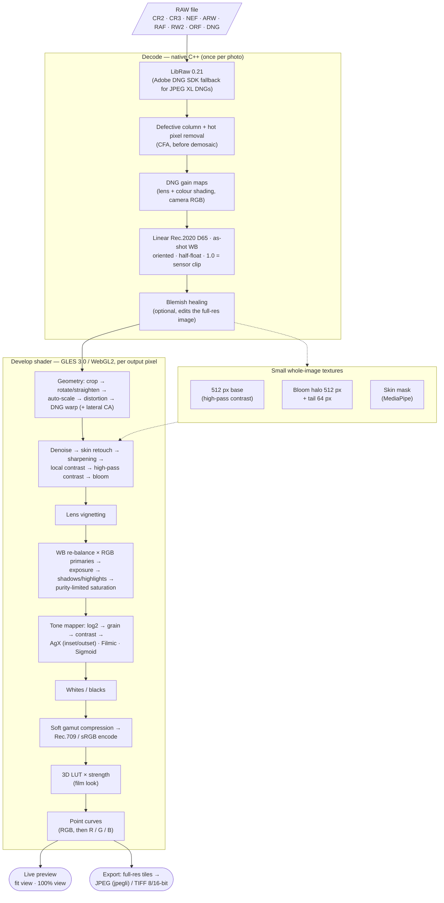

# Pipeline



The same steps as text:

```
raw ──LibRaw (or Adobe DNG SDK)──▶ defective column + hot pixel removal (CFA, before demosaic) ▶ DNG gain maps ▶ linear Rec.2020 (D65), as-shot WB, oriented, half-float
    [blemish healing, when on, edits this full-resolution image]
    ──GPU, per output pixel──▶ crop ▶ rotate/straighten ▶ lens geometry (auto-scale, distortion, DNG warp)
       ▶ denoise ▶ skin retouch ▶ sharpening ▶ local contrast ▶ high-pass contrast ▶ bloom ▶ lens vignetting
       ▶ WB re-balance × RGB primaries ▶ exposure ▶ shadows/highlights ▶ purity-limited saturation
       ▶ tone mapper (AgX: inset ▶ log2 ▶ grain ▶ contrast ▶ sigmoid ▶ outset; Filmic / Sigmoid: log2 ▶ grain ▶ contrast ▶ curve) ▶ whites/blacks ▶ soft gamut compression ▶ Rec.709/sRGB ▶ LUT ▶ point curves
```

- `engine/`: the shared library both apps use
  - `src/main/cpp/`: decoders, JNI bridge, CMake (fetches LibRaw at configure time)
  - `src/main/java/app/rawboy/gl/Shaders.kt`: assembles the develop + AgX shader from `shaders/*.glsl`
  - `src/main/java/app/rawboy/export/`: tiled export, TIFF writer, MediaStore naming
- `shaders/`: the GLSL, compiled into the engine at build time (and shared with a future web build)
- `app-pro/`, `app-auto/`, `app-camera/`: the three apps
- `web/`: RawBoy Web (WASM build of the native code in `web/native`, TypeScript engine port, React UI)
